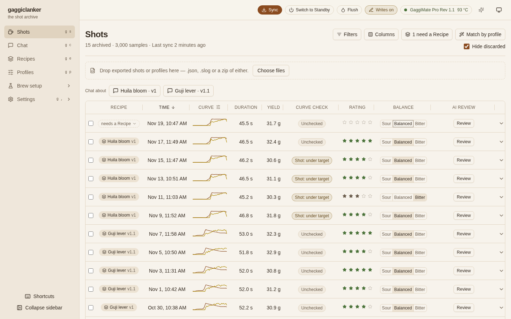
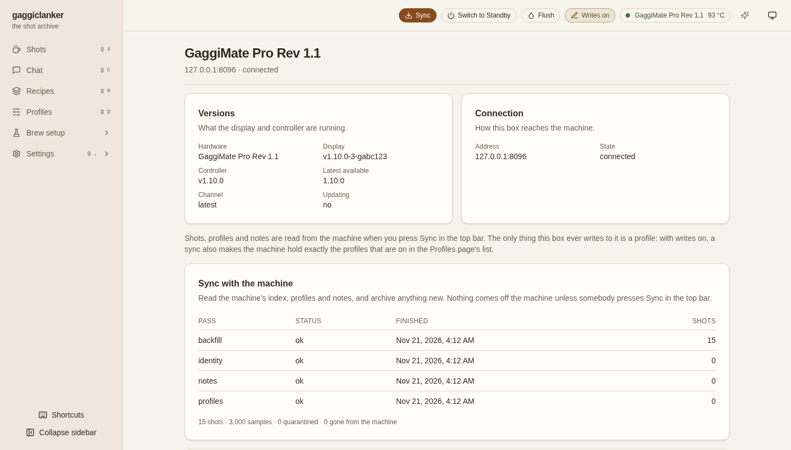
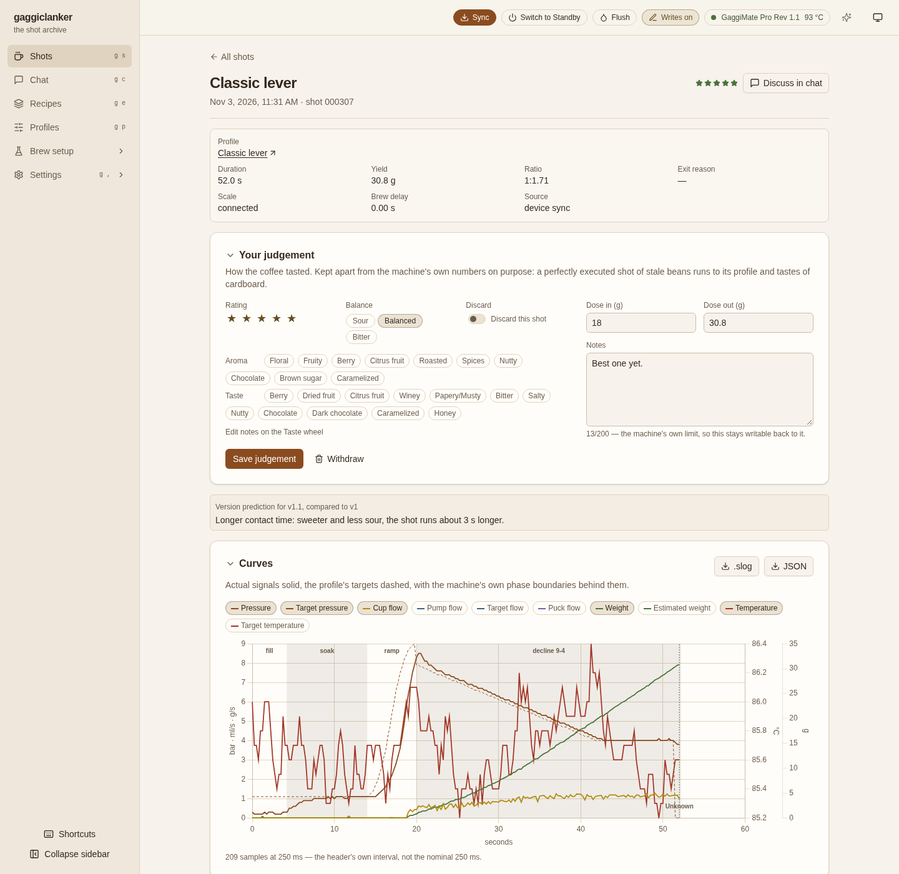
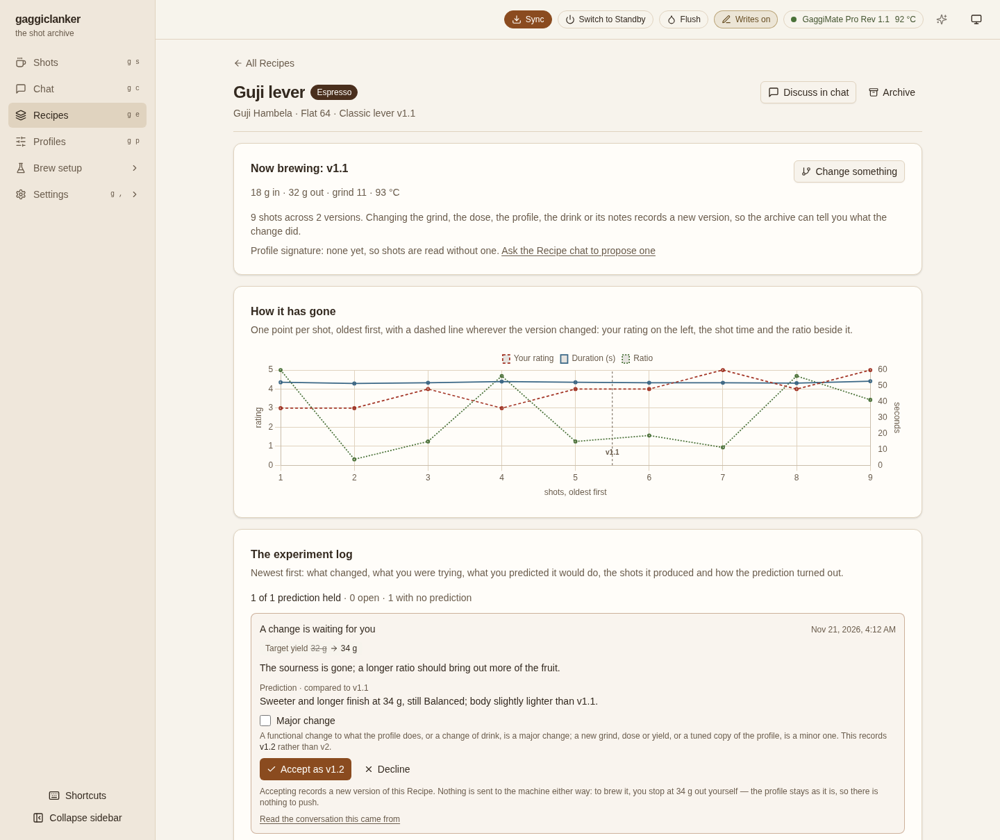
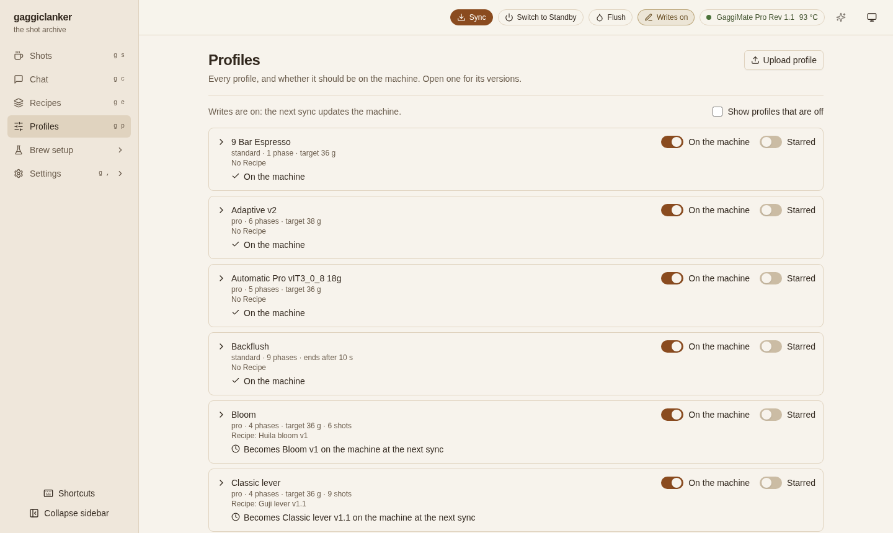
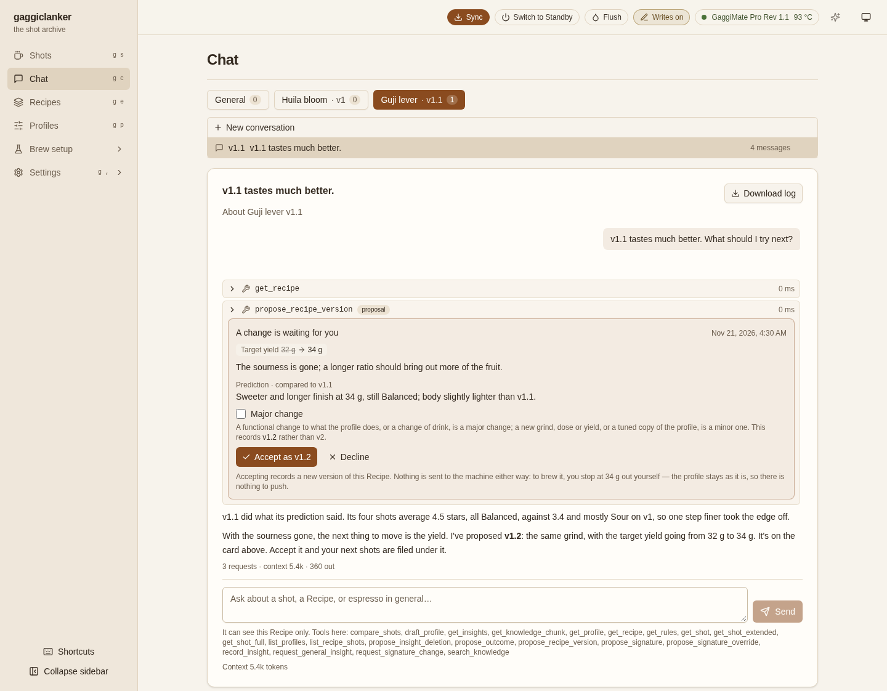

<div align="center">


<h3>gaggiclanker</h3>

A self-hosted archive and analyst for a <a href="https://gaggimate.eu">GaggiMate</a> espresso machine.<br>
It keeps every shot the machine would delete, groups them into versioned Recipes, and talks them through with the language model you choose.

[Documentation](https://joaopn.github.io/gaggiclanker/) · [Getting started](docs/getting-started.md) · [Shots & Recipes](docs/shots-and-recipes.md) · [Profiles](docs/profiles.md) · [Review & chat](docs/review-and-chat.md) · [Configuration](docs/configuration.md) · [Troubleshooting](docs/troubleshooting.md)

</div>

<picture>
  <source media="(prefers-color-scheme: dark)" srcset="docs/assets/hero-dark.png">
  
</picture>

## What it does

- **Archive.** One press of Sync brings in every shot the machine holds (raw `.slog` bytes, every sample, phases, notes) and its profiles, into one SQLite file. Exported files can be dropped in too.
- **Judge.** Curves and deterministic checks for every shot; rate, balance or discard it straight from the list.
- **Recipes.** Bean, grinder, profile, grind, dose and yield, versioned. Each version records what changed, what you predicted, and whether it held.
- **Profiles.** One list of every profile you have had. Switch one on or off the machine; writes are off by default and guarded by [four safety layers](docs/safety-layers.md).
- **Ask.** A model reviews a shot when you ask, and a chat per Recipe proposes the next change for you to accept or decline. Claude Code, Anthropic, OpenAI, OpenRouter, Ollama, LM Studio or any OpenAI-compatible gateway.
- **Local.** One container, one SQLite file, optional sign-in, no telemetry. Works with GaggiMate firmware 1.10.

## Install

You need [Docker](https://docs.docker.com/get-docker/).

```bash
git clone https://github.com/joaopn/gaggiclanker.git
cd gaggiclanker
docker compose up -d --build
```

Open `http://localhost:8042`. Nothing needs copying or editing first: every setting lives in the app. Your data is in `./data`.

Compose uses host networking; give the machine a fixed IP or a DHCP reservation, since its `.local` name often does not resolve from a container. Docker Desktop does not support host networking: [Getting started](docs/getting-started.md) has the alternative, the port, and backups.

<details>
<summary>Update</summary>

```bash
git pull
docker compose up -d --build
```

When a release changes the database, the app backs it up and upgrades it at start.

</details>

<details>
<summary>Run without Docker</summary>

```bash
uv sync
(cd web && npm ci && npm run build)
uv run gaggiclanker            # serves on :8042; PORT=9000 to change it
```

</details>

## How it works

**1\.** Enter the machine's address under **Settings → Machine access** and press **Sync**. The first sync reads its whole history; after that, sync whenever you have pulled some coffee.



**2\.** Judge each shot: stars, balance, taste notes, and its curves against the profile's targets.



**3\.** Dial in a Recipe. Every change is a new version that can carry a prediction, and the experiment log says whether it held.



**4\.** Keep the machine's profiles in one list: switch one on or off, choose its active version, and the next sync makes the machine match.



**5\.** Ask about a Recipe. The chat reads its shots and proposes one change at a time; nothing in the Recipe changes until you accept it.



More in the [docs](docs/getting-started.md). Building on it: [Development](docs/development.md).

## License

[AGPL-3.0-or-later](LICENSE).
