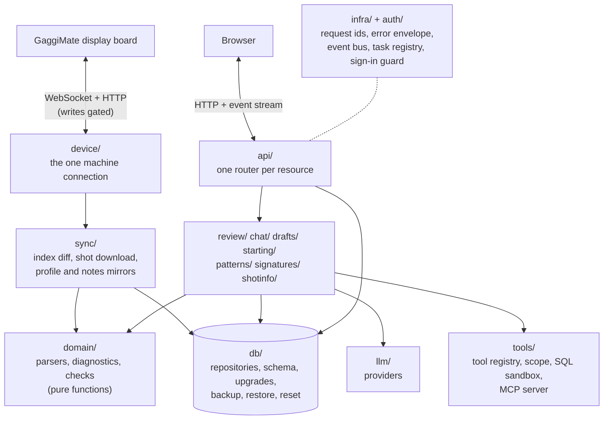
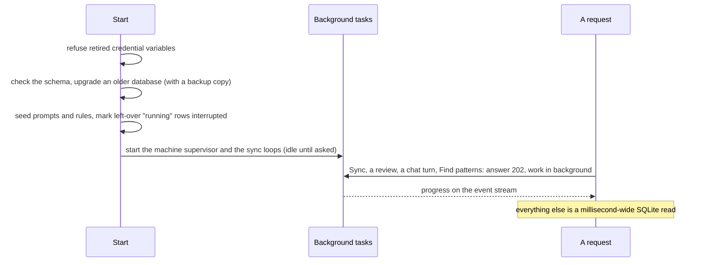

# Architecture

gaggiclanker is one process: a FastAPI app on uvicorn that serves the React UI from the same origin, keeps one SQLite file, holds one WebSocket to the machine, and runs language-model calls as background tasks. Nothing else runs. That is the design, not a stage it has not grown out of yet: it lives next to an espresso machine in a kitchen and has to survive a power cut, a restart, and an owner who has forgotten how it works.

## The pieces and how they connect

Dependencies point downward and never back up: `domain/` knows nothing about HTTP, `db/` knows nothing about the machine, and `device/` knows nothing about the database.

| Area | What it does for the user |
|---|---|
| `device/` | The one connection to the machine: ten reads, seven writes behind the Writes switch. Rebuilt live when the machine settings change. |
| `sync/` | What the Sync button runs: shots, notes, profiles, and the machine's identity. |
| `domain/` | Reading `.slog` shot files and the index, and the numbers: per-phase metrics, warnings, the spread. No score or grade anywhere. |
| `db/` | The only code that writes SQL; the schema, upgrades, backup, restore and reset. |
| `drafts/` | The profile list, the write phase of a sync, the safety policy and the write gate. |
| `signatures/` | What a profile is for: expectations per phase, checked against every shot. |
| `review/`, `knowledge/` | A model's review of one shot; the dial-in rules, the reference prose and confirmed insights. |
| `chat/`, `tools/`, `shotinfo/` | The tool-using conversations, the tools they may call, and how a shot is described to a model. |
| `starting/`, `patterns/` | The starting-point wizard for a new coffee; Find patterns across Recipes. |
| `llm/` | The providers behind every model call. |
| `infra/`, `auth/` | Request ids, the error envelope, the event stream, background tasks, optional sign-in. |
| `web/` | The React UI (Vite, TypeScript, Tailwind, TanStack Query), built into `web/dist` and served by the app. |

## What runs where

Shutdown is the reverse, and it cancels background tasks before closing the database so nothing is mid-write when the file is released.

## Decisions that shape everything

**The machine is a buffer; this is the archive.** The machine has a few hundred KB of storage and deletes its oldest shots under pressure. So the raw shot bytes are stored before anything parses them, a shot that fails to parse is quarantined rather than dropped, and the only thing ever written to the machine is a profile. Losing a shot to a parser bug is worse than storing one nobody can read yet: the bug can be fixed next week, and by then the machine's copy is gone.

**Nothing happens on its own.** A sync, a review, a chat turn and a pattern search each start from a person's click. There is no timer and no pass triggered by a machine event. The one exception is identity (what the machine is, whether it is there), read on connect so the header can say whether the machine is reachable.

**One machine per archive.** The machine is a one-row table describing whatever host is configured now. Pointing the app at a new address updates that row and everything stays attached. A shot is unique by its machine number *and* its start time, because the machine's counter restarts after a settings erase.

**Every response is the same envelope**, success or failure, an unhandled crash included: `{ok, data | error, meta}`, with `meta.request_id` matching the `x-request-id` header and every log line for that request. A user reporting a failure hands over one string that finds it. The middleware is pure ASGI throughout, because Starlette's buffered middleware breaks the event stream the sync reports progress on.

**Every database write goes through a pydantic model, and repositories are the only code that writes SQL.** Routes parse and delegate, services hold the logic.

**A model never changes anything on its own.** Every change an agent suggests — a Recipe version, a grade, a profile, an insight, a deletion — is a stored proposal that a person accepts with a button. No tool reaches the accept routes, and tests walk the tool registry and its bytecode to keep it that way. See [Chat and proposals](chat-and-proposals.md).

**Model calls never run inside the HTTP request.** The route opens a `running` row, hands the work to the task registry and answers at once; the page follows the event stream. A container stop would otherwise kill a two-minute provider call with the browser still waiting. The task name doubles as the idempotency rule, so a second tab pressing the same button gets the running row, not a second bill.

**Configuration lives in the database.** Every setting is one declaration (column, API field, validation, UI control). Only what the process needs before it can open the database comes from the environment, and credentials never do. See [Configuration and data](configuration-and-data.md).

Every decision in full, with the code that holds it, is on [Design decisions](design-decisions.md).
