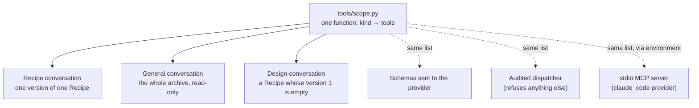
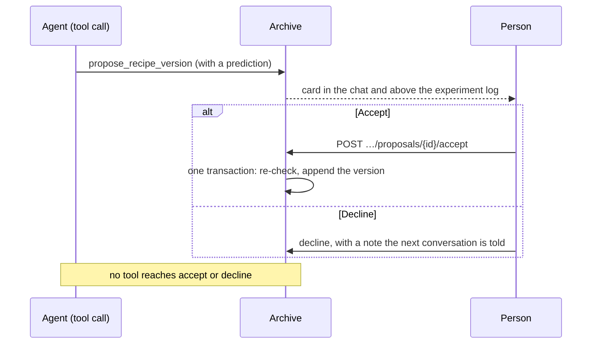

# Chat and proposals

The **Chat** page is the tool-using half of the model layer, the opposite shape from a review: instead of one call with everything in front of it, the model is given tools and asks the archive its own questions. Above the conversation is a row of badges: **General**, then every Recipe you have not archived. A conversation is about one of three things, and what it is about decides what it can reach.

## Three kinds of conversation

| | Recipe | General | Design |
|---|---|---|---|
| **Sees** | That Recipe only: its versions, predictions, outcomes, shots, spread; the knowledge base and the insights that apply | Every Recipe, bean, grinder and shot, through curated SQL views | The Recipe, the profile library, the knowledge tiers; a read-only snapshot of this bean's other Recipes and similar ones on this grinder |
| **Reads with** | `get_recipe`, `list_recipe_shots`, `get_shot`, `get_shot_extended`, `get_shot_full`, `compare_shots`, profiles, knowledge, insights | `query_shots` (SQL sandbox), `describe_schema`, `list_recipes`, `list_beans`, `list_grinders`, the shot tools, profiles, knowledge | `get_recipe`, profiles, knowledge, insights; no shot tools (there are no shots) |
| **Can propose** | Next version (`propose_recipe_version`), an outcome, a profile draft, a signature, insights and their deletion | A profile draft, a general insight or its removal; it cannot change a Recipe and says which badge to open | The whole first version as one card (`propose_initial_recipe`), a signature, a general insight |

A tool outside the scope is not described to the model, and is refused if called anyway, as an error the model can read. A refusal about another Recipe's shot reads the same whether or not the shot exists. The page shows what the server says the conversation has; there is no second list. The design scope is read from the Recipe's flag at the start of every turn, so the turn after the first version is accepted is an ordinary Recipe conversation in the same thread.

**One conversation per change.** **New** in a Recipe's list starts a conversation on the Recipe's current version and it stays on that version, so the list reads as a history of what was argued. **Download log** saves a conversation as one JSON file (messages, tool calls and answers, model and tokens per run; not the per-turn context the app adds).

Each Recipe has a badge on the Chat page with its current version and how many conversations it holds, including Recipes nobody has asked about yet, because an empty list with a **New conversation** button is how you start one. Conversations about a Recipe you have since archived stay readable behind **Show archived Recipes**. The page opens on the newest Recipe unless a link or an open conversation names another, and a question typed before you pick a conversation goes to the open badge's Recipe.

**Discuss in chat** on a Recipe, the **Chat** link on every entry in the experiment log and the Recipe's button in the **Chat about** bar open or continue that version's conversation with the question already typed; pressing any of them twice lands in the same conversation. Rows in a Recipe's list are labelled `v6`, and a version the Recipe later went back past is muted and says *dead end*.

The download is `GET /api/chat/threads/{id}/transcript`, saved as `chat-<id>-<title>.json` and sent with your sign-in like any other call. It holds every message in order with its time and run, the tools the agent called with their arguments and what they answered, and a record per run with the model, its tokens and any error. It leaves out what you never typed: the instructions and the context the app gives the agent each turn (the Recipe's ledger and its recent shots, the base shot glossary). The answer of a tool that renders shots (`get_shot`, `get_shot_extended`, `get_shot_full`, `compare_shots`, `list_recipe_shots`), or one the provider could not pair with its call, is reduced to its size; every other answer, and every refused or failed one, is kept word for word. If the button says the download was blocked before it reached the app, a content-blocking extension dropped the request: allow this site in it.

Every answer shows what was called, with the input and the output one click away, and citations are links: a shot id goes to the shot, a knowledge passage's heading path goes to the passage. A turn is bounded by `chatMaxToolRounds` and `chatMaxToolCalls`; the Stop button cancels a run mid-answer, and the transcript survives a reload because the stream is replayed from the database rather than held in the tab.

The tool counts today: a Recipe conversation has seventeen tools, twelve reads and five that propose (`propose_outcome`, the next version, an insight, the deletion of an insight, a profile draft); a General conversation has seventeen, sixteen reads and one proposal, the profile draft; a design has eight. The registry holds twenty-three in total: twelve both kinds have, ten that belong to one kind or the other, and `propose_initial_recipe`, which only a design has. `get_profile` reads any other profile version's whole document, three tools read one shot (`get_shot` its base information, `get_shot_extended` the rest, `get_shot_full` both), and `list_recipe_shots` searches the Recipe's shots on their base information (filters, ranges, a sort, at most ten back). None of them starts a shot's review or answers one of its claims, and nothing in the chat can touch the machine.

**The agent is handed the experiment before it says a word:** the Recipe and its numbers, every version with what changed, what was predicted, against which version and how it turned out, the track record, how much this Recipe's shots vary when nothing changed, the evidence table this version's prediction is graded on, this version's newest shots (twenty by default, `chatRecentShots`) with the discards marked, the Good shots that are the target, and the insights you have confirmed. A Recipe conversation also starts with the profile its version brews, as stored.

**A design is started by `POST /api/recipes/design`**, which takes a bean and a grinder (both required), optionally a profile to fork, your usual grind on that grinder and what you want from the coffee, and creates a Recipe whose version 1 has no numbers yet, with that version's conversation open. The first message is what you wanted, or "Help me design this Recipe." when you left it empty, so the agent starts by asking. The grinder is required because a grind is only a number on one grinder's dial, so pre-ground coffee keeps the plain form and the starting-point suggestion.

Whichever of the form's grind, dose and yield you filled in goes with it as your decision: the agent proposes exactly those numbers, designs the profile around them (a yield you chose is where its last phase stops) and works out only what you left empty, changing one of yours only when you ask. A yield the picked profile filled in counts as filled; clear it to leave it to the agent. The form's intent is not sent, because the design asks what you want instead, and the Recipe page shows the numbers it keeps under the brief.

A newer first-version card replaces the waiting one. Accepting fills version 1 in place and ends the design conversation: the agent is told, and tells you to talk version 1's shots through in a new conversation. Its profile is approved with the card, under the Name you typed on it, so **Accept and sync** is the whole way to the machine; with Writes off, **Accept** leaves it for the first sync after Writes goes on. Writing a version by hand, which must name a profile no Recipe has, ends the design the same way. The Recipes list, the Recipe page and its Chat badge carry a **Designing** badge with **Continue designing**, and `DELETE /api/recipes/{id}/design`, the **Discard design** button, deletes a design nobody brewed anything under, after asking; one with a shot filed on it is kept.

## Proposals: the agent asks, a person decides

| Proposal | Becomes real when | Rules the agent cannot dodge |
|---|---|---|
| Next Recipe version | You press **Accept** (sends nothing to the machine) | Needs a prediction; two changes at once only with a reason they cannot be separated; none while the current version's prediction is ungraded; one waiting at a time |
| Outcome (grade) | **Accept**, **Record another outcome**, or **Dismiss** | Worked out from all the version's counted shots; a waiting grade is read only by its own version's conversation |
| Profile draft | **Approve** on the proposal card ([Profile sync](profile-sync.md)) | Inside a Recipe it carries a prediction like any version |
| Recipe insight | **Add** or **Dismiss** | Must rest on at least one shot or one version with a recorded outcome |
| General insight | **Add** on the Knowledge page | Refused without a quote found in your own messages |
| Removing or replacing an insight | **Delete**/**Keep**, or **Add** on the replacement | Only on your own words for a general one; until you press, the insight stays |

**A proposal stops waiting when the Recipe moves on.** Recording a version on the form, going back, or making a profile proposal active retires a waiting proposal in the same transaction, so nobody is left an Accept button that could only refuse, and the next conversation is told the Recipe is somewhere else now. **Whatever was accepted at create can be applied at accept**: every reference a proposal names is checked when it is made, not when someone clicks.

**Why proposals are their own tables.** A version is a thing that was brewed; giving it a "not yet" lifecycle would make every average, group and chart owe a filter, and the one that forgot it would quietly count a suggestion nobody accepted. The proposal also carries what only a proposal has: its conversation, the version it was made against, a decline's note. This replaced an earlier tool that appended a version the moment a model asked, which filed the next shot under a version nobody had agreed to.

**Why no tool can accept.** An agent that could accept its own proposal would have exactly the power the proposal was invented to take away. Tests walk the tool registry and the tool package's bytecode for every accept, dismiss, delete and approve.

A next-version card appears in the conversation and again above the experiment log. It says what would move, why, and what is predicted (*compared to v4, expect 3 to 5 s longer and less sour*). Accepting records the change as the Recipe's next version with that prediction on it and sends nothing to the machine. The accepted card says what you do instead: for a grind, dose or yield change the profile on the machine is already the right one, so there is nothing to push (*set the grinder to 1 and brew; the next shots on this profile are filed under v2 by themselves*); a change to another profile says to select it on the machine. The agent can only propose a profile the machine has (`list_profiles` says which); any other goes through a profile draft. Declining creates nothing, and the note you leave is what the next conversation is told.

While the current version's own prediction is still ungraded the agent cannot propose the next change at all: it grades that one with you, or asks for another shot on the same version, which needs no new version.

A profile change is a change to the version too, so a draft proposed inside a Recipe's conversation carries a prediction and obeys the same rules. It lands on the Profiles page as a proposal inside its profile: you read the diff and make it active (one click, which approves it), and the Recipe records the new version, with the prediction, in the same step.

**Accept** on a card in the conversation also tells the agent, as your next message ("Accepted: your proposed change (Grind 2 → 1) is now version 2 of this Recipe"), and it answers by sending you to a new conversation for the new version; the one you are in stays with the version it was opened on. **Decline** tells it too, with your reason ("Declined: the dose is not the problem", or "Declined: no reason given."), and it answers in the same conversation without sending that card again. Answering on the Recipe page tells no conversation.

When a proposal is retired because the Recipe moved on, the log says so and the next conversation is told, so the agent can propose afresh against what you are brewing now.

## Insights and Find patterns

- **An insight belongs to the Recipe it was learned in.** It is stored with that Recipe and the version, told to that Recipe's later conversations and to no other Recipe's, even on the same bean and grinder.
- **General insights** live on the Knowledge page: what you write by hand, ones you save from your own message ("Save as general insight"), ones you add from an agent's request, and ones approved from Find patterns. They reach every conversation whose Recipe matches their scope (bean, grinder, roast, process).
- **An insight rests on versions.** It names the versions whose recorded outcome it depends on; when you change such an outcome later, the insight shows the old one beside it ("held → failed"). Nothing expires by itself: only you remove an added insight.
- **Find patterns across Recipes** (Knowledge page, Insights tab) is one model call with no tools, only on the button. It reads every Recipe's confirmed insights and proposes general ones that several Recipes say in different words. A proposal resting on one Recipe, naming an insight it was not given, or with a scope its sources do not share is dropped before you see it. **Approve** writes the general insight and deletes the Recipe insights it came from, so each Recipe hears the lesson once. Copies of insight text live one run: a finished run deletes every earlier run's proposals and blanks their stored input.

A Recipe insight shows as a card in the chat with **Add** and **Dismiss**, and is listed on that Recipe's page under the version it was learned at (waiting ones with their buttons, added ones with **Take back**). Nothing waiting or dismissed reaches a prompt, and neither the design chat of a new Recipe nor Review ever sees a Recipe's insights. The Knowledge page holds general knowledge only, and general insights keep matching by bean, grinder, roast and process.

The agent is told each added insight as a line with its number, the version it was learned at, what it rests on and its shots, and is asked to weigh an old insight, or one resting on a changed outcome, below the current shots. The Recipe page and the chat card show each version with its outcome as it stands now, and, when the outcome was re-recorded or cleared after the insight was written, the old one beside it with a "changed since" mark ("held → failed", "no outcome now"); the outcome it had when written is never rewritten.

When the shots contradict an insight, the agent proposes its **replacement**: a card showing the old text above the new, "Adding it deletes the old insight". Your Add adds the new one and deletes the old one in one step, and if the old one changed in the meantime the new one is added on its own and the card says so. When an insight is no longer supported and nothing replaces it, the agent proposes **deleting** it with its reason (a card with **Delete** and **Keep**, from `propose_insight_deletion`, Recipe conversations only). At the start of a new version's conversation the agent is asked to look over the added insights and propose replacing or deleting the few the shots no longer support, never as a sweep of all of them.

Removed means removed: nothing is kept as a retired state, a history row or a restore; only the conversation that proposed the removal still shows the text on its card and is told what you did. Deleting a conversation also deletes the insights it proposed that you dismissed (they existed only to stop it offering them again); waiting and added ones stay.

A Find patterns run reads the confirmed insights of every Recipe (the Recipe's name and attributes, the version each was learned at and what it rests on), the general insights that already exist and the proposals you declined before. The Insights tab says how many confirmed Recipe insights arrived since the last run and keeps the button off until two Recipes have one. Each proposal card shows its text, the Recipes it applies to, and the Recipe insights it was derived from, grouped by Recipe and linked. A source that was deleted or taken back since the run is left alone and named on the card, and an approval is refused when fewer than two Recipes' insights remain; when the proposal says it replaces an existing general insight, that one is deleted too. Approve and Dismiss wait while a run is going, because the run replaces the proposals when it finishes. The model is `modelPatterns` under Settings → LLM → Models, falling back to the default model.

## How a shot reaches a model

Every item a shot carries (checks, each diagnostic, each phase's metrics, each curve channel, your judgement, the kept review claims) is one entry in a catalogue with a stable key, its meaning, a default tier and one renderer. **Base** items are what the model sees without asking (the opening context's recent shots, the shot search, `get_shot`); **extended** items are what it asks for. A curve is a table of about sixty rows chosen to keep its shape and the moments the diagnostics are about. A value the machine did not record is left out, never written as zero. You move items between tiers under Settings → Shot information. The glossary is generated from the same catalogue, so an item and its explanation cannot drift apart.

The base information starts with the shot's **checks** (the warnings and the signature's results), then what it is and where it is filed, its outcome, the headline diagnostics and your judgement. The extended information is the temperature, pressure and flow statistics, profile compliance, one line per phase (how it ended, the cup at its end and its share of the target, the flows, the water, the pressure) and the curve. The curve comes as about sixty rows (`chatCurvePoints`), and it always keeps each phase's start and end, peak pressure, first drip and the largest pressure drop. The meanings of the extended fields arrive once with a shot read in detail (`get_shot_extended`, `get_shot_full` or `compare_shots`): each says what it measures, its unit and which way is better, and none carries a grade.

Under **Settings → Shot information** there is one table per group, each item with what it means, a base | extended | excluded control and its value on your newest judged shot, written by the same renderer the agent reads. An excluded item is left out of the opening context, the shot tools, the search and the glossary, though a General chat's SQL tool can still read the archive's views. Shot id, Recipe version and whether a shot counts stay in base, since the agent cannot search or cite without them. The page shows the cost in approximate tokens (base and extended per shot, the curve at `chatCurvePoints`, the glossary in its two halves, and the opening context's shots at `chatRecentShots`), a change applies from the next turn, and **Reset to defaults** puts every item back. Only the items you moved are stored, so an item a later release adds arrives at its default.

## The chat's database tool over MCP

For the `claude_code` provider the tool loop runs inside the Claude Code CLI, out of the app's dispatcher. So the same registry is served as an MCP server over stdio (`gaggiclanker mcp`), which the provider spawns with the conversation's scope in its environment. It opens the archive and nothing else: no network endpoint, no machine connection, no setting. Read and propose only.

The command stays available so the provider can spawn it, and it deliberately never creates the database: a second process creating the schema of a database the application is also using is a race, so the app must have started once first. There are no device-write tools and no switch that adds any: the machine is written only by gaggiclanker's own HTTP API, behind buttons a person presses. The API providers call the same tools directly and never start the server.
