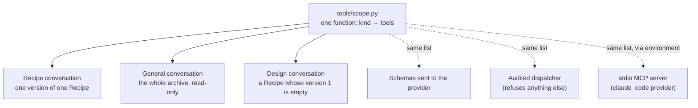
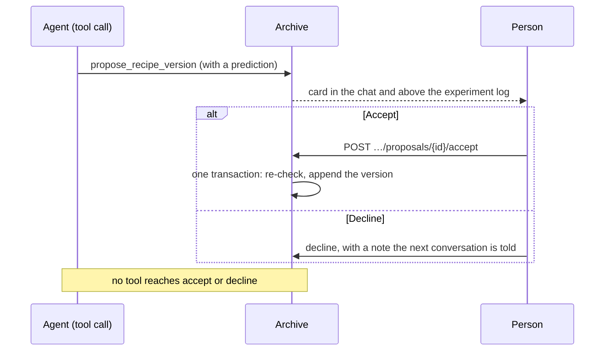

# Chat and proposals

The **Chat** page is the tool-using half of the model layer, the opposite shape from a review: instead of one call with everything in front of it, the model is given tools and asks the archive its own questions. Above the conversation is a row of badges: **General**, then every Recipe you have not archived. A conversation is about one of three things, and what it is about decides what it can reach.

## Three kinds of conversation

| | Recipe | General | Design |
|---|---|---|---|
| **Sees** | That Recipe only: its versions, predictions, outcomes, shots, spread; the knowledge base and the insights that apply | Every Recipe, bean, grinder and shot, through curated SQL views | The Recipe, the profile library, the knowledge tiers; a read-only snapshot of this bean's other Recipes and similar ones on this grinder |
| **Reads with** | `get_recipe`, `list_recipe_shots`, `get_shot`, `get_shot_extended`, `get_shot_full`, `compare_shots`, profiles, knowledge, insights | `query_shots` (SQL sandbox), `describe_schema`, `list_recipes`, `list_beans`, `list_grinders`, the shot tools, profiles, knowledge | `get_recipe`, profiles, knowledge, insights; no shot tools (there are no shots) |
| **Can propose** | Next version (`propose_recipe_version`), an outcome, a profile draft, a signature, insights and their deletion | A profile draft, a general insight or its removal; it cannot change a Recipe and says which badge to open | The whole first version as one card (`propose_initial_recipe`), a signature, a general insight |

A tool outside the scope is not described to the model, and is refused if called anyway, as an error the model can read. A refusal about another Recipe's shot reads the same whether or not the shot exists. The page shows what the server says the conversation has; there is no second list. The design scope is read from the Recipe's flag at the start of every turn, so the turn after the first version is accepted is an ordinary Recipe conversation in the same thread.

**One conversation per change.** **New** in a Recipe's list starts a conversation on the Recipe's current version and it stays on that version, so the list reads as a history of what was argued. **Download log** saves a conversation as one JSON file (messages, tool calls and answers, model and tokens per run; not the per-turn context the app adds).

## Proposals: the agent asks, a person decides

| Proposal | Becomes real when | Rules the agent cannot dodge |
|---|---|---|
| Next Recipe version | You press **Accept** (sends nothing to the machine) | Needs a prediction; two changes at once only with a reason they cannot be separated; none while the current version's prediction is ungraded; one waiting at a time |
| Outcome (grade) | **Accept**, **Record another outcome**, or **Dismiss** | Worked out from all the version's counted shots; a waiting grade is read only by its own version's conversation |
| Profile draft | **Approve** on the proposal card ([Profile sync](profile-sync.md)) | Inside a Recipe it carries a prediction like any version |
| Recipe insight | **Add** or **Dismiss** | Must rest on at least one shot or one version with a recorded outcome |
| General insight | **Add** on the Knowledge page | Refused without a quote found in your own messages |
| Removing or replacing an insight | **Delete**/**Keep**, or **Add** on the replacement | Only on your own words for a general one; until you press, the insight stays |

**A proposal stops waiting when the Recipe moves on.** Recording a version on the form, going back, or making a profile proposal active retires a waiting proposal in the same transaction, so nobody is left an Accept button that could only refuse, and the next conversation is told the Recipe is somewhere else now. **Whatever was accepted at create can be applied at accept**: every reference a proposal names is checked when it is made, not when someone clicks.

**Why proposals are their own tables.** A version is a thing that was brewed; giving it a "not yet" lifecycle would make every average, group and chart owe a filter, and the one that forgot it would quietly count a suggestion nobody accepted. The proposal also carries what only a proposal has: its conversation, the version it was made against, a decline's note. This replaced an earlier tool that appended a version the moment a model asked, which filed the next shot under a version nobody had agreed to.

**Why no tool can accept.** An agent that could accept its own proposal would have exactly the power the proposal was invented to take away. Tests walk the tool registry and the tool package's bytecode for every accept, dismiss, delete and approve.

## Insights and Find patterns

- **An insight belongs to the Recipe it was learned in.** It is stored with that Recipe and the version, told to that Recipe's later conversations and to no other Recipe's, even on the same bean and grinder.
- **General insights** live on the Knowledge page: what you write by hand, ones you save from your own message ("Save as general insight"), ones you add from an agent's request, and ones approved from Find patterns. They reach every conversation whose Recipe matches their scope (bean, grinder, roast, process).
- **An insight rests on versions.** It names the versions whose recorded outcome it depends on; when you change such an outcome later, the insight shows the old one beside it ("held → failed"). Nothing expires by itself: only you remove an added insight.
- **Find patterns across Recipes** (Knowledge page, Insights tab) is one model call with no tools, only on the button. It reads every Recipe's confirmed insights and proposes general ones that several Recipes say in different words. A proposal resting on one Recipe, naming an insight it was not given, or with a scope its sources do not share is dropped before you see it. **Approve** writes the general insight and deletes the Recipe insights it came from, so each Recipe hears the lesson once. Copies of insight text live one run: a finished run deletes every earlier run's proposals and blanks their stored input.

## How a shot reaches a model

Every item a shot carries (checks, each diagnostic, each phase's metrics, each curve channel, your judgement, the kept review claims) is one entry in a catalogue with a stable key, its meaning, a default tier and one renderer. **Base** items are what the model sees without asking (the opening context's recent shots, the shot search, `get_shot`); **extended** items are what it asks for. A curve is a table of about sixty rows chosen to keep its shape and the moments the diagnostics are about. A value the machine did not record is left out, never written as zero. You move items between tiers under Settings → Shot information. The glossary is generated from the same catalogue, so an item and its explanation cannot drift apart.

## The chat's database tool over MCP

For the `claude_code` provider the tool loop runs inside the Claude Code CLI, out of the app's dispatcher. So the same registry is served as an MCP server over stdio (`gaggiclanker mcp`), which the provider spawns with the conversation's scope in its environment. It opens the archive and nothing else: no network endpoint, no machine connection, no setting. Read and propose only.
