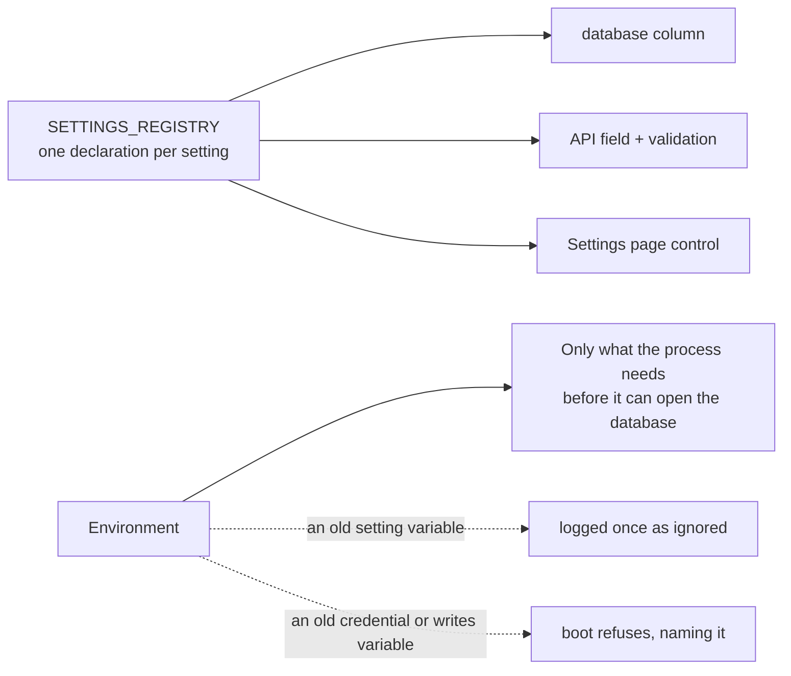
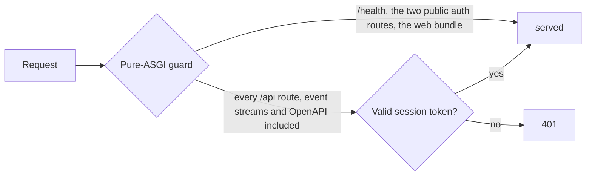
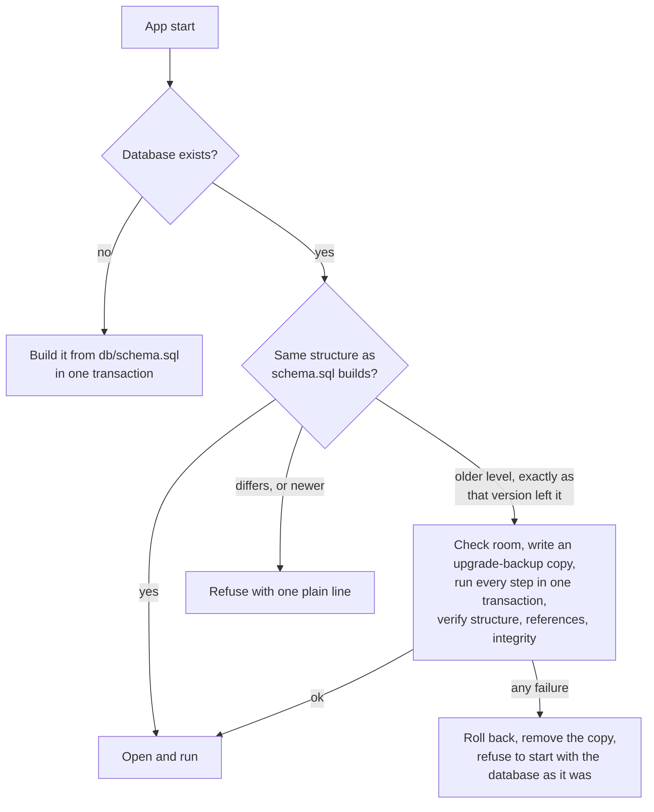

# Configuration and data

Everything is configured in the app and kept in its one SQLite file. A checkout is ready to start as it comes, a `git pull` has no file of yours to conflict with, and nothing changed in the UI reverts on restart.

## Where configuration comes from

A setting is what the database holds or what its declaration defaults to — nothing else. `GET /api/settings` says which of the two each key came from. Secrets are write-only through the API: a read returns a four-character hint.

| From the environment (set by the image) | What it is |
|---|---|
| `DATA_DIR` | Where the SQLite file lives (`./data`, `/app/data` in the image) |
| `HOST`, `PORT` | Bind address and port (8042). The port is the one value given at spawn, because the app must bind before it can read a database |
| `LOG_LEVEL`, `LOG_JSON` | Log verbosity and JSON or console lines |
| `WEB_DIST` | Where the built UI is |
| `CORS_ORIGINS` | Origins allowed to call the API; only the Vite dev server needs one |

| Settings page | What lives there |
|---|---|
| Machine access | `gaggimateHost` (an address, no scheme), protocol, timeout, the sync switch. Applies immediately: the connection is rebuilt with no restart |
| LLM | Provider, credentials, models per kind of call, timeouts, chat and knowledge budgets ([Language models](language-models.md)) |
| Authentication | Optional sign-in |
| Prompts, Knowledge, Shot information | The editable prompts, the rules and prose, which shot items are base or extended |
| Profile safety | The bounds of the safety policy ([Machine safety](safety-layers.md)) |
| System, Import | Backup, restore, reset; dropping exports |

**Why no environment.** Two surfaces that configure the same thing will disagree, and the Settings page would then be lying about the box. A variable that used to configure a setting is named once at boot and ignored. Two kinds stop the boot instead: any variable that used to carry a credential, and the retired device-writes variable. Silently ignoring either would leave the box less protected than its owner believes. `compose.yml` forwards exactly those names so a stale `.env` stops the container loudly.

Nothing parses a `.env`, however the app is run: not the settings, not the bootstrap values, not the credential check. A boot that finds a file called `.env` beside it logs `dotenv_file_ignored` with its full path, so it is not mistaken for configuration. Compose is the one thing that still looks at such a file, and only in one narrow way: it substitutes `${VAR}` in `compose.yml` from a `.env` in the project directory, and `compose.yml` names exactly the variables a boot refuses. So a stale `.env` holding a sign-in variable, a provider key or the device-writes variable still stops the container, with the names in the log, while a stale `DATA_DIR` or `PORT` in the same file reaches nothing. The `environment:` block of `compose.yml` carries exactly one real setting, `PORT`, because the app must bind before it can read a database; everything else in it is a name the boot refuses.

A boot that finds a variable that used to carry a credential (or that an SDK would read one from), in any letter case, or a proxy variable with a user or password in it, logs `auth_env_refused` with the variable names (never a value) and exits, rather than start with authentication silently switched off; empty values count as unset. The retired device-writes variable does the same under `device_writes_env_refused`: a switch that used to open the only path to the machine must not change meaning quietly. A variable that used to configure an ordinary setting is logged once as `setting_env_ignored`, names only, and the database's values are used.

**Upgrading from a release that read settings from the environment.** Values that were set in an old `.env`, in `compose.yml`'s `environment:` or in the shell have to be stored in the database before the pull, because none of it is read afterwards. There is a trap on the old version: typing the same value into its Settings page and pressing Save does not store it. The form sends only the fields whose value differs from the one it is showing, and on the old version a value coming from the environment is already the value shown, so Save sends an empty change and the value is lost at the upgrade. Two ways round it, both on the old version: change the field to something else, save, change it back and save again; or store the values in one request, `PATCH /api/settings` with a JSON body such as `{"gaggimateHost": "192.168.1.50", "gaggimateTimeoutSeconds": 20}` (port 8000 was the old version's default; add the bearer header if sign-in is on), and check with `GET /api/settings` that every moved key reads `"source": "database"`. Any variable that used to carry a credential, and the device-writes variable, make the new version refuse to boot rather than be ignored, because ignoring either would leave the box less protected than its owner believes. An install that had sign-in configured only through the environment starts with sign-in off until it is set again.

## Sign-in

Off until you turn it on, because the common case is a box on a home network where the espresso machine itself has no auth, no TLS and no CORS. It is configured only under Settings → Authentication: set the password (hashed with argon2id on the server; the hash cannot be stored directly), then the username, which is what turns the lock. Nothing in the environment can set, seed or override either. The password box posts the plain password to `POST /api/auth/password`, which hashes it and stores only the hash. The settings API refuses to store a hash directly (`authPasswordHash` is read-only there) because a masked box labelled "password hash" invites typing the *password* into it, and a stored value argon2 cannot verify is a credential that authenticates nobody.

- The switch is re-read on every request, so turning it on takes effect with no restart.
- A change of password or username revokes every session, the one that made it included: the tokens are the credential once issued (they last thirty days), and leaving one working after a password change would be theatre. Signing out revokes the session on the server rather than only forgetting it in the browser, so a token that leaked can be killed from any other tab.
- `/health` stays public because a healthcheck that needs a token is not a healthcheck, and so does the web app itself; everything the app can actually *do* is an API call. Auth is the boundary, not a full security posture: one user, no roles, no TLS of its own.
- Five failed sign-ins from one address buy a sixty-second lock.
- A stored hash that is not a hash leaves auth **on** and refusing everyone: a configuration mistake must never take the lock off the door.
- A test enumerates the app's own OpenAPI document and checks every route answers 401, so a router added later is covered the day it is mounted.

## Backup, restore, reset

| Action | What happens | Why it is built that way |
|---|---|---|
| **Download backup** | A consistent snapshot (`VACUUM INTO` on its own connection) with a small manifest; API keys and tokens left out unless ticked; sessions never included | It can be taken while the app is running and syncing, which a plain copy of a database with a hot WAL cannot promise |
| **Restore from file** | The upload is staged and checked (integrity, the app's tables, size under 1 GB); a backup from an earlier version is upgraded on the staged copy by the same steps as a boot upgrade, and the preview says so. Confirming replaces everything, switches Writes off, signs everyone out, keeps current keys the file lacks, and restarts the app | The swap is one rename at shutdown, so a crash leaves either the old data or the new, never neither |
| **Reset** | Writes a `reset-requested` marker and stops; the next start deletes everything **before the database opens**, including keys and the downloaded CLI, and switches sign-in off. Nothing on the machine changes | A kill after the answer still ends in a fresh install, and no old write-ahead log is replayed onto the new database |

Restore and reset are refused while a sync, a chat answer, a review or another background job is running. Under a launcher that does not restart a stopped process, start the app again by hand.

A backup carries a small `backup_manifest` table saying when and by which version it was taken. The API keys and tokens left out by default are the LLM API key, the Anthropic key, the Claude Code token and the session signing key; nothing of them remains in the file's bytes. The sign-in user and password hash are always in it, so a restored app still asks for a password. A restore stops the app's own chat runs before the swap; an MCP client started outside the app (stdio) keeps the old file open until it reconnects. A crash during the swap leaves the old data (and a staging file the next start deletes) or the new. By hand, a restore is a file copy of the downloaded file over `data/gaggiclanker.db` with `data/gaggiclanker.db-wal` and `data/gaggiclanker.db-shm` deleted, because the sidecars belong to the file they were written next to and leaving them beside a restored database reinstates the state being undone.

While a reset is pending, `gaggiclanker import` and `gaggiclanker mcp` refuse to start, since they would write to a database that is about to be deleted. What is left in `DATA_DIR` afterwards is a new `gaggiclanker.db`.

## The schema and upgrades

- `db/schema.sql` builds the whole database and ends with `PRAGMA user_version = N`, the number of upgrade steps (14 today, in `db/upgrades/`). The comparison is by structure, not text, so editing a comment never refuses a database.
- **A step is frozen code with raw SQL.** It imports nothing from the rest of the app, so a repository that changes later cannot change what an old step does, and the schema of every level is kept as a checksummed file beside it. A schema change ships its step in the same commit.
- Only the app's own start upgrades; `gaggiclanker import` and `gaggiclanker mcp` refuse a database that is behind and say to start the app once.
- Data that moves without a step is derived data, rebuilt at boot from what is stored.
