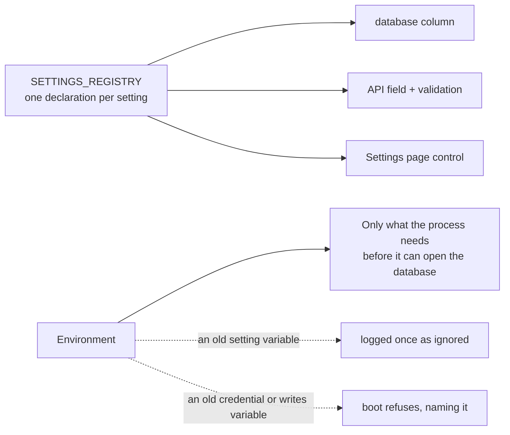
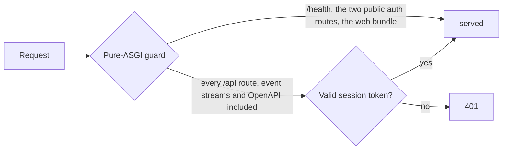
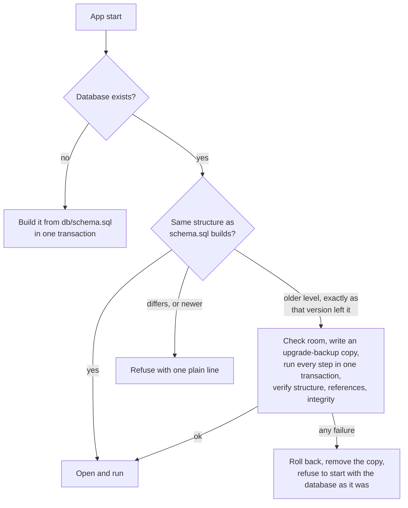

# Configuration and data

Everything is configured in the app and kept in its one SQLite file. A checkout is ready to start as it comes, a `git pull` has no file of yours to conflict with, and nothing changed in the UI reverts on restart.

## Where configuration comes from

A setting is what the database holds or what its declaration defaults to — nothing else. `GET /api/settings` says which of the two each key came from. Secrets are write-only through the API: a read returns a four-character hint.

| From the environment (set by the image) | What it is |
|---|---|
| `DATA_DIR` | Where the SQLite file lives (`./data`, `/app/data` in the image) |
| `HOST`, `PORT` | Bind address and port (8042). The port is the one value given at spawn, because the app must bind before it can read a database |
| `LOG_LEVEL`, `LOG_JSON` | Log verbosity and JSON or console lines |
| `WEB_DIST` | Where the built UI is |
| `CORS_ORIGINS` | Origins allowed to call the API; only the Vite dev server needs one |

| Settings page | What lives there |
|---|---|
| Machine access | `gaggimateHost` (an address, no scheme), protocol, timeout, the sync switch. Applies immediately: the connection is rebuilt with no restart |
| LLM | Provider, credentials, models per kind of call, timeouts, chat and knowledge budgets ([Language models](language-models.md)) |
| Authentication | Optional sign-in |
| Prompts, Knowledge, Shot information | The editable prompts, the rules and prose, which shot items are base or extended |
| Profile safety | The bounds of the safety policy ([Machine safety](safety-layers.md)) |
| System, Import | Backup, restore, reset; dropping exports |

**Why no environment.** Two surfaces that configure the same thing will disagree, and the Settings page would then be lying about the box. A variable that used to configure a setting is named once at boot and ignored. Two kinds stop the boot instead: any variable that used to carry a credential, and the retired device-writes variable. Silently ignoring either would leave the box less protected than its owner believes. `compose.yml` forwards exactly those names so a stale `.env` stops the container loudly.

## Sign-in

Off until you turn it on, because the common case is a box on a home network where the espresso machine itself has no auth, no TLS and no CORS. It is configured only under Settings → Authentication: set the password (hashed with argon2id on the server; the hash cannot be stored directly), then the username, which is what turns the lock.

- The switch is re-read on every request, so turning it on takes effect with no restart.
- A change of password or username revokes every session, the one that made it included. Signing out revokes the session on the server.
- Five failed sign-ins from one address buy a sixty-second lock.
- A stored hash that is not a hash leaves auth **on** and refusing everyone: a configuration mistake must never take the lock off the door.
- A test enumerates the app's own OpenAPI document and checks every route answers 401, so a router added later is covered the day it is mounted.

## Backup, restore, reset

| Action | What happens | Why it is built that way |
|---|---|---|
| **Download backup** | A consistent snapshot (`VACUUM INTO` on its own connection) with a small manifest; API keys and tokens left out unless ticked; sessions never included | It can be taken while the app is running and syncing, which a plain copy of a database with a hot WAL cannot promise |
| **Restore from file** | The upload is staged and checked (integrity, the app's tables, size under 1 GB); a backup from an earlier version is upgraded on the staged copy by the same steps as a boot upgrade, and the preview says so. Confirming replaces everything, switches Writes off, signs everyone out, keeps current keys the file lacks, and restarts the app | The swap is one rename at shutdown, so a crash leaves either the old data or the new, never neither |
| **Reset** | Writes a `reset-requested` marker and stops; the next start deletes everything **before the database opens**, including keys and the downloaded CLI, and switches sign-in off. Nothing on the machine changes | A kill after the answer still ends in a fresh install, and no old write-ahead log is replayed onto the new database |

Restore and reset are refused while a sync, a chat answer, a review or another background job is running. Under a launcher that does not restart a stopped process, start the app again by hand.

## The schema and upgrades

- `db/schema.sql` builds the whole database and ends with `PRAGMA user_version = N`, the number of upgrade steps (14 today, in `db/upgrades/`). The comparison is by structure, not text, so editing a comment never refuses a database.
- **A step is frozen code with raw SQL.** It imports nothing from the rest of the app, so a repository that changes later cannot change what an old step does, and the schema of every level is kept as a checksummed file beside it. A schema change ships its step in the same commit.
- Only the app's own start upgrades; `gaggiclanker import` and `gaggiclanker mcp` refuse a database that is behind and say to start the app once.
- Data that moves without a step is derived data, rebuilt at boot from what is stored.
