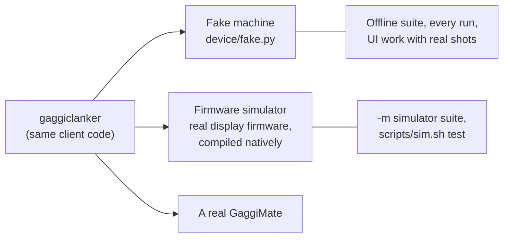

# Development and testing

How the repository is built, run without a machine, and checked. The commands are below and in [scripts/README.md](https://github.com/joaopn/gaggiclanker/blob/main/scripts/README.md); this page is how the pieces fit and why.

```bash
uv sync                                                        # install into .venv/
uv run uvicorn gaggiclanker.main:app --reload --no-access-log  # dev server on :8042
uv run pytest                                                  # the suite, offline, on every core
uv run pytest -n 0 tests/sync/test_pull.py                     # one file, without the worker start-up
scripts/gates.sh                                               # the checks your change owes
```

`scripts/gates.sh` reads what your branch changed since `origin/dev`, committed
or not, and runs the checks that change owes: ruff, mypy, the suite and an API
schema check for the back end, the front end's own checks and build for `web/`,
and it tells you when the firmware simulator suite is owed as well. `--dry-run`
prints the plan without running it; `scripts/README.md` has the rest.

The API documents itself at `/api/docs`. Every response uses the envelope
`{ok, data | error, meta}` — including an unhandled crash; `meta.request_id`
matches the `x-request-id` header and every log line for that request.

Running the app outside Docker, `DATA_DIR` defaults to `./data` and the app
creates it. If it cannot write there it says so at startup, with the path and
the uid, rather than failing later with SQLite's "unable to open database file".

## Working without a machine

There is a fake GaggiMate in the package. It is a real HTTP + WebSocket server
loaded from `tests/fixtures`, with the firmware's quirks reproduced — 2 Hz
telemetry, `evt:history-shot-saved`, half-written `.slog` files, the SPA served
where binary was asked for, the three-client limit:

```bash
uv run python -m gaggiclanker.device.fake --port 8090   # in one terminal
uv run uvicorn gaggiclanker.main:app --reload           # in another
curl -X PATCH localhost:8042/api/settings \
  -H 'content-type: application/json' -d '{"gaggimateHost": "127.0.0.1:8090"}'
```

The address is a setting like any other, so it is entered once — in the UI under
Settings → Machine access, or with the `PATCH` above — and stays in the archive's
database file for every later run. The connection is rebuilt on save, so the app
does not need restarting.

It holds the fixture archive, so pressing Sync in the top bar against it fills
the UI with real shots and real curves.

Or seed the archive from files, with no machine at all. The web UI on the
display exports a shot as `shot-<id>.json` and a profile as `profile-<id>.json`;
those files are the only way back for a shot the machine has already deleted,
and the importer reads them into the same tables the sync engine writes.
Importing first and connecting the machine afterwards is an ordinary order to do
things in: the archive holds one machine, it exists before the first sync, and a
shot the sync engine later serves is recognised as the one already stored.

```bash
uv run gaggiclanker import tests/fixtures/exports       # or any folder, file or zip
uv run gaggiclanker import ~/exports --replace          # overwrite what is already stored
```

The same thing is `POST /api/import` and the strip at the top of the **Shots**
page: drop a folder of exports on it, or press **Choose files**, and it reports
what each file did. Importing the same shot twice is a no-op, and a file that
does not parse is reported on its own — the rest of the batch still lands. A
profile export dropped on the **Profiles** page lands the same way.

The whole offline suite runs against it, so "works against the fake" means
rather more than it usually does. `scripts/sim.sh test` is the next step up: it
clones the firmware to a scratch tree, patches its simulator shim, builds the
real display firmware natively and runs the `-m simulator` tests against it.
The reference checkout under `external/` is never modified.

## Three ways to have a machine



| | The fake machine | The simulator | Exports |
|---|---|---|---|
| **What it is** | A real HTTP + WebSocket server in the package, loaded from `tests/fixtures`, reproducing the firmware's quirks (2 Hz telemetry, shot-saved events, half-written `.slog` files, the SPA served where binary was asked for, the three-client limit, the 1.10 refusals) | The firmware cloned to a scratch tree, its simulator shim patched, built natively; pinned to firmware 1.10 | `shot-<id>.json` and `profile-<id>.json` from the machine's web UI |
| **Used for** | The whole offline suite, and a UI full of real shots: point `gaggimateHost` at it and press Sync | Checking the client against the actual parser and brew code: every profile fixture saved and read back, one profile synced, brewed and removed | Seeding an archive with no machine at all (`gaggiclanker import`) |
| **Catches** | Everything the firmware's documented and reproduced behaviour can show | What only the real firmware does (it caught the identity frame being rejected on every real machine) | — |

The reference checkouts under `external/` (the firmware, its docs, related tools) are read, never modified.

## Testing shape

A real app, a real SQLite file, a temp `DATA_DIR` per test, `httpx.ASGITransport`
in process. No in-memory database and no mocked repositories, because WAL,
foreign keys and `VACUUM INTO` only exist on a real file.
The device layer runs against `gaggiclanker/device/fake.py`, a real server that
reproduces the firmware's quirks; the opt-in `-m simulator` suite then runs the
same code against the actual firmware compiled natively.

Several tests guard **decisions** rather than features, so a later change cannot undo one by accident:

| Test guards | Decision |
|---|---|
| The device client's public surface | Ten reads and seven gated writes, nothing else ([Machine safety](safety-layers.md)) |
| Every route answers 401 with sign-in on | A router added later is covered the day it is mounted |
| No tool reaches an accept, approve or delete | Only a person decides ([Chat and proposals](chat-and-proposals.md)) |
| Outbound isolation | No credential is taken from the environment ([Language models](language-models.md)) |
| Profile temperature in every query | One rule, repeated in SQL, pinned to the Python one |
| One test file per upgrade level | Each frozen step still carries a database forward ([Configuration and data](configuration-and-data.md)) |
| No retired words | Nothing a model is handed mentions the retired execution score or threshold bands: a number carries no grade |

## What a change owes: `scripts/gates.sh`

| Changed | Gates |
|---|---|
| Back end, tests, `pyproject.toml`, `uv.lock` | ruff check and format, mypy, pytest, then `npm run gen:api`, which must leave the generated API types unchanged |
| `web/` | `npm run check` (Biome, TypeScript, Vitest), `npm run build` |
| `device/`, `sync/`, `drafts/`, the simulator | `scripts/sim.sh test`, reported as owed, run with `--sim` |

**Bugs get a reproduction before a fix.** A `scripts/repro_<bug>.py` exits non-zero while the bug exists and zero once it is fixed, verified on the base branch and the fix branch. The fix lands with a gated test that fails the same way, and the script goes with it; the ones still in `scripts/` cover what no gate can (building the image, running the simulator).

## The front end

`web/` is Vite + React 18 + TypeScript, Tailwind v4 with shadcn/ui, TanStack Query, React Router, react-hook-form with zod, Chart.js, Biome and Vitest. Its API types are generated from the back end's OpenAPI document, which is why `gen:api` is a back-end gate. The build goes to `web/dist`, which the app serves from `/` with a fallback for client-side routes; in development the Vite server proxies `/api` to the back end on 8042.

## Shipping

One image (`Dockerfile`) with the built UI and a pinned Claude Code CLI; `compose.yml` runs it with host networking by default (so `.local` names and a long-lived WebSocket work without NAT) and a `./data` bind mount. The entrypoint starts as root only to hand `./data` to the app user, then drops privileges before any application code runs. `CHANGELOG.md` records what each release changed, including every breaking change and what it does to existing data.

## Documentation

* [Architecture](architecture.md) — what the pieces are and why
  they are arranged this way; [Design decisions](design-decisions.md) has each
  decision in full.
* [Firmware behaviours](device-gotchas.md) — the fifteen firmware
  behaviours that shaped the sync engine. Read before touching `device/` or
  `sync/`.
* [Machine safety](safety-layers.md) — what can harm the machine,
  and the four layers that will guard a write when there is one.
* [`CHANGELOG.md`](https://github.com/joaopn/gaggiclanker/blob/main/CHANGELOG.md) — what is in each release.

## Contributing

[Design decisions](design-decisions.md) holds the conventions — the
response envelope, pydantic on every database write, repro-first bug fixing,
the schema rule and the list of device gotchas worth knowing before
touching the sync code. [`CHANGELOG.md`](https://github.com/joaopn/gaggiclanker/blob/main/CHANGELOG.md) has what landed in each
release.
