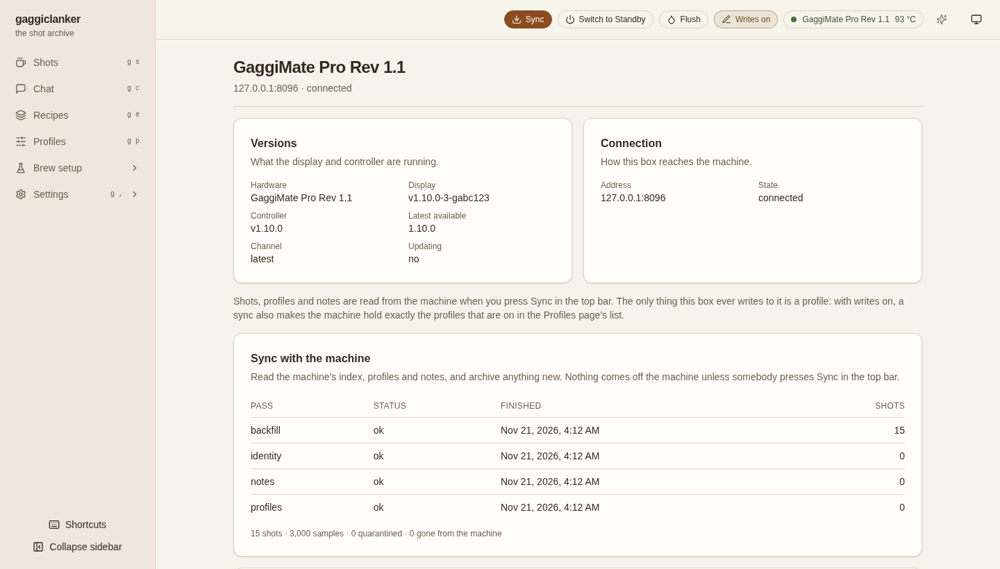

# Getting started

gaggiclanker keeps every shot your [GaggiMate](https://gaggimate.eu) espresso machine records. The machine deletes old shots when it runs low on space. This archive does not. It shows each shot with its curves, lets you rate it, groups shots into versioned **Recipes**, and can talk a shot through with a language model you choose.

*How this works: [Architecture](architecture.md).*

It does not watch the machine live. Nothing is copied until you press **Sync**. It works with GaggiMate firmware 1.10; shots and profiles from older firmware still read.

## Quick start

```bash
git clone https://github.com/joaopn/gaggiclanker.git && cd gaggiclanker
docker compose up -d --build         # builds the image and starts on :8042
curl localhost:8042/health           # {"ok":true,"data":{"status":"ok",...}}
open http://localhost:8042           # the UI
```

There is nothing to copy or edit first. Everything is configured in the UI.

The port is the one thing given on the command line. It defaults to 8042. Give it again every time you start the app, from your shell or from a `.env` in this directory that Compose reads:

```bash
PORT=9000 docker compose up -d --build   # host networking, the default here
HOST_PORT=9000 docker compose up -d      # bridge: published on 9000, container stays on 8042
PORT=9000 uv run gaggiclanker            # a source checkout, no Docker
```

`compose.yml` uses host networking by default, so the app is on port 8042 of the box you started it on. Docker Desktop does not support that. Swap in the `ports:` block the file documents next to it, and use an IP for the machine's host.

**To update**, pull and rebuild. When a release changes the database, the app backs it up and upgrades it at start.

```bash
git pull
docker compose up -d --build
```

**To run without Docker:**

```bash
uv sync
(cd web && npm ci && npm run build)
uv run gaggiclanker            # serves on :8042; PORT=9000 to change it
```

## First run

1. **Open the UI** at `http://localhost:8042`.
2. **Set the machine's address in Settings → Machine access.** `gaggimateHost` is the display board's IP or hostname, with no scheme (`192.168.1.50`, or `192.168.1.50:80`). It connects when you save, with no restart. The pill in the header goes green within a few seconds. Prefer a fixed IP or a DHCP reservation; see [Troubleshooting](troubleshooting.md) for why the name your browser resolves may not resolve here.
3. **Press Sync** in the top bar, on any page. The first sync reads the machine's whole history, which takes a minute or two for a few hundred shots. When it finishes it says what it archived, how many profiles it read from the machine and how many it wrote to it, for example "Read 9 profiles from the machine; no writes (writes are off)". Shots under 7.5 seconds never appear: the firmware discards them. After that, sync whenever you have pulled some coffee. To bring back shots the machine has already deleted, drop exported files on the strip under the header.
4. **Turn on authentication** if anything you do not trust can reach this box. See [Authentication](configuration.md#authentication). It is off by default, which is right for a machine only your own network can reach.
5. **Set up the model.** A review and the chat need one provider. The cheapest to get working is `claude_code`, which uses a Claude subscription you may already have. Run `claude setup-token` on any machine with the Claude CLI installed and paste the token into **Settings → LLM**. An interactive `claude login` is not enough. Any OpenAI-compatible gateway works too; see [LLM settings](review-and-chat.md#llm-settings).
6. **Take a backup** once there is something worth keeping: **Settings → System → Backup & restore → Download backup**, or `curl -o backup.db 'localhost:8042/api/backup?include_keys=false'`.



Your data lives in `./data`, one SQLite file. Back it up from the Settings page (it is safe while the app is running), or copy that directory while the app is stopped. You do not need to create `./data` first. If you would rather not have the container fix its ownership, `compose.yml` documents a named-volume alternative next to the mount.
