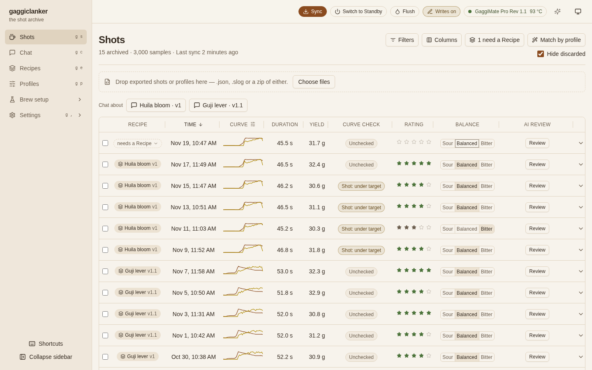
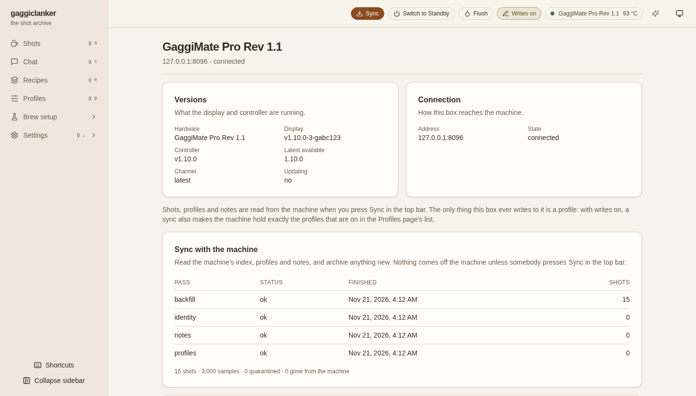
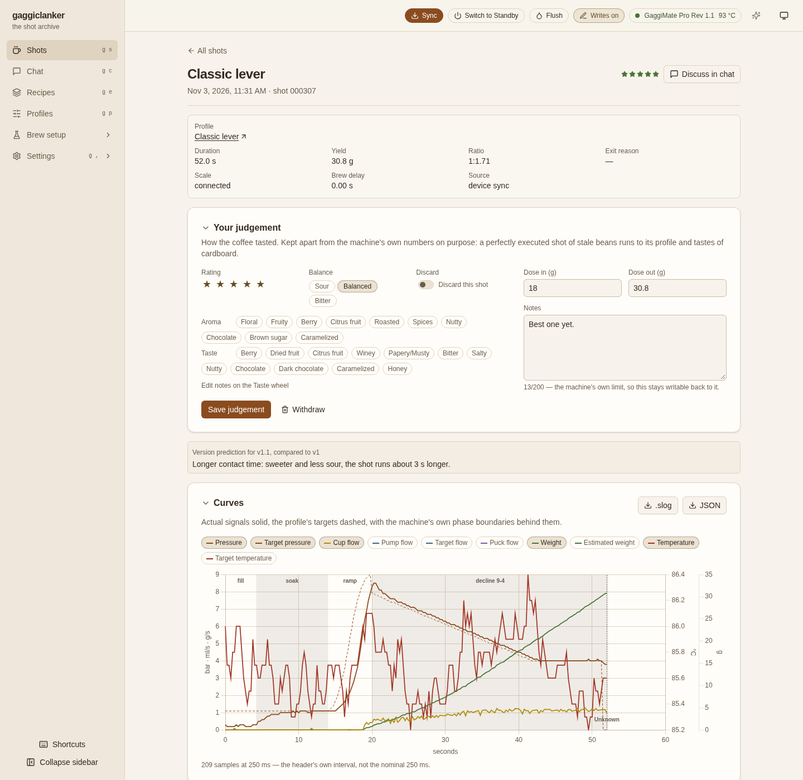
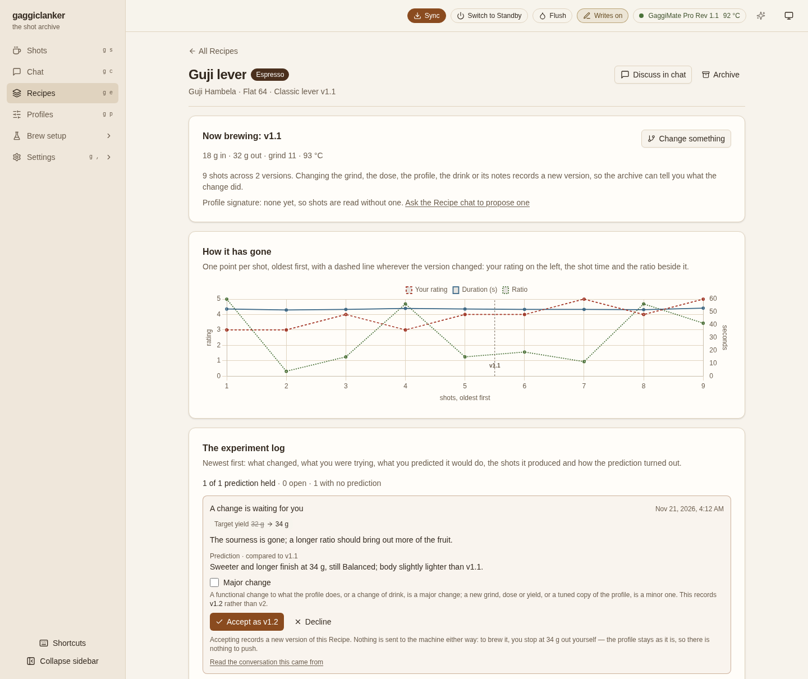
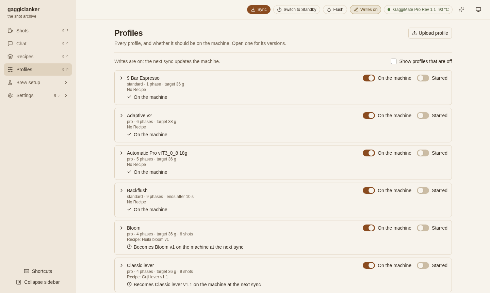
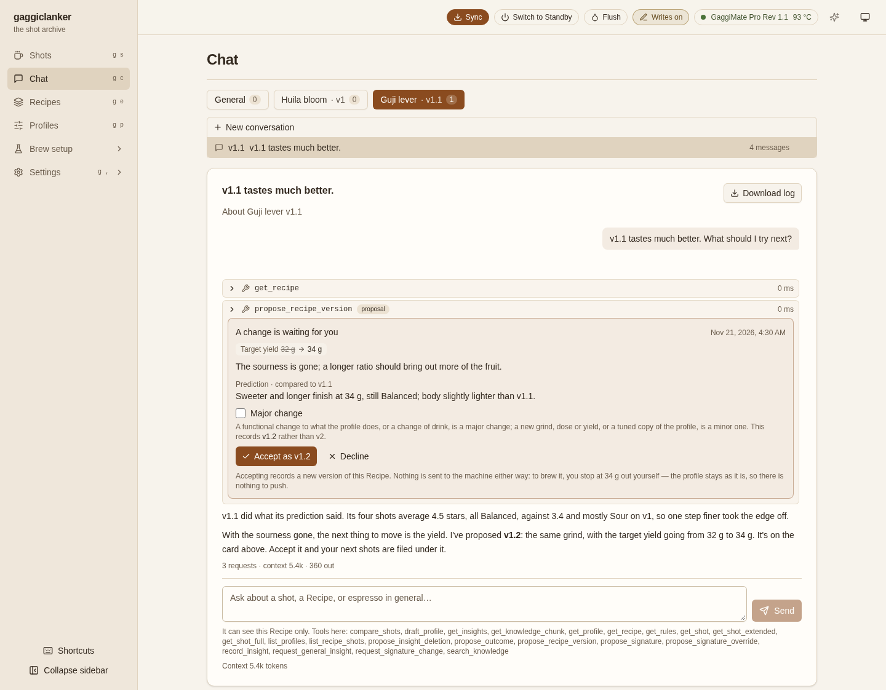

# gaggiclanker

A self-hosted archive for a [GaggiMate](https://gaggimate.eu) espresso machine. It keeps every shot the machine would delete, groups them into versioned Recipes, and talks them through with the language model you choose.

## What it does

- **Archive.** One press of Sync brings in every shot the machine holds (raw `.slog` bytes, every sample, phases, notes) and its profiles, into one SQLite file. Exported files can be dropped in too.
- **Judge.** Curves and deterministic checks for every shot; rate, balance or discard it straight from the list.
- **Recipes.** Bean, grinder, profile, grind, dose and yield, versioned. Each version records what changed, what you predicted, and whether it held.
- **Profiles.** One list of every profile you have had. Switch one on or off the machine; writes are off by default and guarded by [four safety layers](safety-layers.md).
- **Ask.** A model reviews a shot when you ask, and a chat per Recipe proposes the next change for you to accept or decline. Claude Code, Anthropic, OpenAI, OpenRouter, Ollama, LM Studio or any OpenAI-compatible gateway.
- **Local.** One container, one SQLite file, optional sign-in, no telemetry. Works with GaggiMate firmware 1.10.

## How it works

**1\.** Enter the machine's address under **Settings → Machine access** and press **Sync**. The first sync reads its whole history; after that, sync whenever you have pulled some coffee. See [Getting started](getting-started.md).

**2\.** Judge each shot: stars, balance, taste notes, and its curves against the profile's targets. See [Shots and Recipes](shots-and-recipes.md).

**3\.** Dial in a Recipe. Every change is a new version that can carry a prediction, and the experiment log says whether it held. See [The experiment log](shots-and-recipes.md#the-experiment-log).

**4\.** Keep the machine's profiles in one list: switch one on or off, choose its active version, and the next sync makes the machine match. See [Profiles and the machine](profiles.md).

**5\.** Ask about a Recipe. The chat reads its shots and proposes one change at a time; nothing in the Recipe changes until you accept it. See [Review and chat](review-and-chat.md).

## The docs

- **[User guide](user-guide.md)**: install it, sync your shots, dial in a bean, fix problems. Start with [Getting started](getting-started.md).
- **[Architecture](architecture.md)**: how it works inside and why it was built that way.
