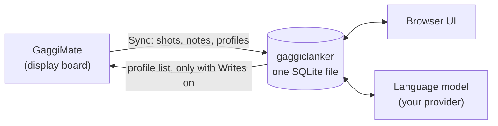

# gaggiclanker

gaggiclanker is a self-hosted archive and analyst for a GaggiMate espresso machine. The machine is a small buffer that deletes its oldest shots when its storage runs low; gaggiclanker is the place that keeps them. One press of **Sync** brings in every shot, the machine's notes and its profiles into one SQLite file. Each shot gets curves and deterministic checks, and you judge it. Shots are grouped into versioned **Recipes** (bean, grinder, profile, grind, dose, yield) whose versions carry predictions you grade. The profiles live in one list that a sync can make the machine match. A language model you choose reviews a shot when you ask and talks a Recipe through, but it only ever *proposes*; you decide. It all runs as one container next to the machine, and nothing happens on a timer.

## User guide

For the person running it: installing, syncing, dialling in, and fixing problems.

| Page | What it covers |
|---|---|
| [Getting started](getting-started.md) | What gaggiclanker is, how to start it, and what the first run looks like |
| [Shots and Recipes](shots-and-recipes.md) | The pages, the Shots list and a shot's page, the Recipes experiment log and how much your shots vary anyway |
| [Profiles and the machine](profiles.md) | The profile list, what gets written to the machine and how to put a profile on it |
| [Review and chat](review-and-chat.md) | Choosing a language model, a shot's review, the chat, and designing a Recipe with it |
| [Configuration](configuration.md) | The Settings pages, optional sign-in, backup, restore and reset |
| [Troubleshooting](troubleshooting.md) | What to check when the machine will not connect, a shot is missing or a review stalls |

## Architecture

How it works and why:

| Page | What it covers |
|---|---|
| [Architecture](architecture.md) | The one process, its layers, what runs where, and the decisions that shape all of it |
| [Design decisions](design-decisions.md) | Every design decision in full, with the code that holds it |
| [Sync and the archive](sync-and-the-archive.md) | What pressing Sync does, how shots are stored and filed, importing exports, and the firmware quirks the sync is built around |
| [Firmware behaviours](device-gotchas.md) | The fifteen firmware behaviours the sync engine is built around |
| [Recipes and versions](recipes-and-versions.md) | How a Recipe dials in a bean: versions, predictions and outcomes, the spread, going back, dead ends, archiving |
| [Profile sync](profile-sync.md) | The profile list, how a sync makes the machine match it, conflicts, names, duplicates and pins |
| [Machine safety](safety-layers.md) | Everything that can reach the machine, the Writes switch, and the four layers every profile write passes |
| [Shot checks and review](shot-checks-and-review.md) | The Curve check (signatures and warnings) and the model's review of one shot, and why they are two columns |
| [Chat and proposals](chat-and-proposals.md) | The three kinds of conversation, the tools each has, proposals only a person accepts, insights, Find patterns and the starting-point wizard |
| [Language models](language-models.md) | The providers, how credentials are kept, how calls run in the background and fail safely |
| [Configuration and data](configuration-and-data.md) | Where configuration lives, optional sign-in, backup, restore, reset and database upgrades |
| [Development and testing](development.md) | The fake machine, the firmware simulator, the test shape and the gates a change owes |
