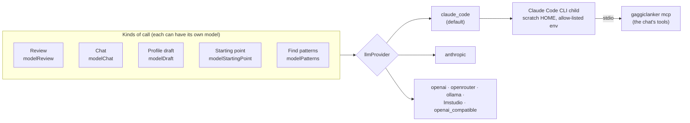
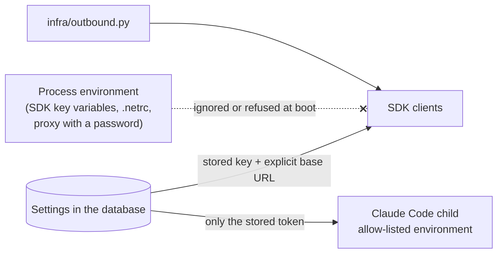

# Language models

Every model call — a shot's review, a chat turn, a profile draft, a starting point, Find patterns — goes through one provider, chosen under **Settings → LLM**. Nothing calls a model on its own: each call starts from a person's click.

## Providers

| Provider | Credential (stored in the database only) | Notes |
|---|---|---|
| `claude_code` (default) | `claudeCodeOauthToken`, from `claude setup-token` | Runs the Claude Code CLI against a Claude subscription, so there is no API key to buy. Its tool loop runs inside the CLI, which reaches the chat's tools through the stdio MCP server. `claudeCodeEffort` sets how hard it thinks |
| `anthropic` | `anthropicApiKey` | The Anthropic SDK with an explicit base URL |
| `openai`, `openrouter`, `ollama`, `lmstudio`, `openai_compatible` | `llmApiKey` (and `llmBaseUrl` for a gateway) | Presets over one OpenAI-compatible client |

`modelDefault` is the default model; the per-kind settings override it, and an empty value lets the provider choose. **Validate credentials** tries what the form holds before it is saved; for `claude_code` it makes one one-word call, because `claude auth status` cannot tell a working token from a revoked one.

**The Claude Code CLI.** The Docker image ships a pinned CLI. The Claude Code panel under Settings → LLM can install the `stable` or `latest` channel, or an exact version, from npm into the data directory: checked against the registry's sha512, run once before the app switches to it, kept across restarts, and set aside once a newer image carries that release. Nothing updates on its own.

A source checkout has no CLI in it: install it (`npm install -g @anthropic-ai/claude-code`) or point `claudeCodeBin` at it.

The installed release is used while `claudeCodeBin` is left at `claude`, and the panel's **Use the image's version** button removes it.

Each provider has its own credential and none is ever lent to another: `llmApiKey` for the OpenAI-compatible presets, `anthropicApiKey` for `anthropic`, `claudeCodeOauthToken` for `claude_code`.

## How calls run

- **In the background, never inside the request.** The route opens a `running` row, hands the work to the task registry and answers 202; the page follows the event stream. The task name is the idempotency rule, so two tabs pressing the same button pay once.
- **A failure is a stored row, not an exception.** A run cut off by a restart is marked `interrupted` at the next boot.
- **Rate limits stop the whole app's calls, once.** `llmRateLimitRetries` is a process-wide budget, not per call: when the account is throttled the next call would fail too, and failing sixty shots slowly is worse than stopping. The latch is cleared from Settings → LLM.
- **Each attempt is bounded** by `llmTimeoutSeconds`.
- **The call ledger** keeps the rendered prompt and the raw reply on each call's row (capped at 200 KB each) while `llmStoreCallText` is on, because prompts are editable: without the text, a review stored today could not be explained after its prompt changed.
- **Prompts are database rows**, seeded from the YAML files in `gaggiclanker/prompts/` and edited under Settings → Prompts; an edit applies from the next call, no restart.

## Credentials stay in the database

Every outbound HTTP client is built by `infra/outbound.py`: it ignores `.netrc`, uses an environment proxy only when it names no user or password, and does not follow redirects. The SDK clients are always handed the stored key and an explicit base URL, and discard the SDKs' own environment headers, organisation and project variables and profile discovery. The CLI child gets an allow-listed environment whose only credential is the stored token, and a scratch `HOME`, which is why an interactive `claude login` is not enough: the scratch home keeps the repository and `~/.claude` out of every prompt.

**Why.** A key that a library picks up from the environment is a second surface that can disagree with the Settings page, and one the owner cannot see. A boot that finds one of the SDKs' credential variables set refuses to start, naming it; a test sets every candidate variable to a sentinel and inspects the requests. Any future outbound connection follows the same rule.
