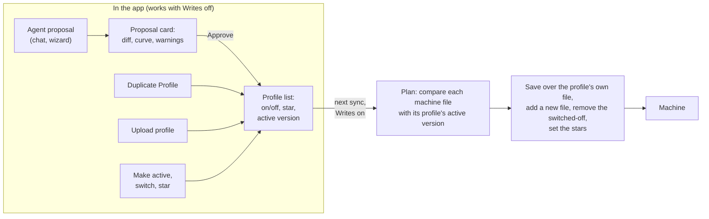

# Profile sync

The **Profiles** page is one list of every profile you have had. Each row has two switches, **On the machine** and **Starred** (the machine's home-screen carousel), its versions with one active, and a line saying where it stands on the machine and what the next sync will do about it. Editing the list sends nothing to the machine: with the **Writes** switch on, the end of every sync makes the machine hold exactly what the list says.

## From a person's decision to the machine

**The first sync with Writes on** takes the machine's profiles into the list as they are and writes nothing; the switch's confirmation says so, and afterwards previews what the next sync would do. From then on a sync:

| Situation on the machine | What the sync does |
|---|---|
| A profile that is on has no file | Saves a new file; the id the firmware assigns becomes the profile's file, for good |
| Its file holds an older version | Saves the active version over that same file, so its star, selection and startup setting stay |
| A profile is switched off | Removes its file, only if a fresh load holds exactly what was recorded |
| A file the app has never seen | Joins the list, switched on, untouched by the sync that found it |
| A file edited on the display | Becomes a **conflict**: nothing is done until you choose **Keep the app's** or **Keep the machine's** (either is stored as a version) |
| The machine's backflush and descale (firmware 1.10) | Always "Kept by the machine"; the switch cannot change them |
| The machine looks reset (none of the files the last sync left is there) | Syncs stop writing and the page asks once whether to put the profiles back |
| An eleventh star | Refused, with the limit named: the machine shows at most ten starred profiles |

The machine seeds the backflush and descale profiles at every boot (firmware 1.10), and its own delete refuses them. At sync time a star beyond the tenth is left unstarred and the sync says so.

**Approve and sync** on a proposal card approves it (the profile's active version, switched on; for a Recipe's profile also the Recipe's next version) and starts a sync; with Writes off it is **Approve**, and the profile goes to the machine at the first sync after Writes is turned on. It never selects the profile on the machine; you still do that. There is no Delete: switching a profile off removes it from the machine, and the profile and its versions stay in the list.

The proposal card shows the change in the agent's words, its prediction for a Recipe, the profile's curve beside the active version's on the same axes (pro profiles; a new profile shows one), what changes (a new profile is shown whole), the stop-condition warning when it moves when the machine stops pumping, and for a new profile a **Name** field, prefilled with the agent's name and checked against the list as you type. The Recipe's next version carries the prediction when the proposal was made in the Recipe's conversation.

After the click the card goes on telling the truth in the server's words: syncing, on the machine (and whether it is the selected profile), not on the machine and why (with a link to the profile), declined or replaced. In a conversation the answer is also told to the agent, with your note when you declined.

## Names

No two profiles in the list share a name, and only you rename a profile. A Recipe's profile is shown on the machine with the Recipe's current version after it ("Alma Lever v1.3"), so a new version renames the machine's file in place; the name you edit never carries the version.

| Who renamed it | Next sync |
|---|---|
| You, in the app | The file is renamed at the next sync with Writes on |
| Someone at the machine | The profile takes the machine's name, with Writes on or off |
| Both sides | A conflict: **Keep** either |
| The machine's new name is another profile's | A conflict: **Keep** your name (renames it back) or **Rename to …** |
| A machine file with a name already in the list | Joins as "&lt;name&gt; (2)" and the file is renamed |

Until a rename made in the app is sent, the row says "Becomes <name> on the machine at the next sync". A name given at the machine carries a note under **On the machine** until the sync after. **Rename** on an open profile opens a Name field (Enter renames, Escape cancels). A proposal that would make a second profile with a name the list already has is refused: its panel says the list already has that profile, and offers Decline.

## Versions, drafts, duplicates and pins

- **A profile version belongs to one profile.** Two profiles that brew the same thing have two versions (a Duplicate, a pin's copy). Every path that lists a version on a profile goes through one function, so a profile never takes another profile's version.
- **Two hashes, never one.** A version's identity is its **brew** (the canonical document without the name), so the same brew under another name is the same version. What guards the machine — the read-back after a save, the delete guard, the audit, a conflict — is the **document** hash, which includes the name.
- **A draft** is decided once when it is made: a change to one profile (it keeps the profile's name) or a new profile with a name of its own. A name that is already a profile is refused.
- **Duplicate Profile** makes a new profile from any version, under a name you type, validated as you type against the schema and the safety policy, and adds it switched on. No proposal to approve.
- **A pin** keeps a Recipe version on the machine as a profile of its own: a copy that belongs to that Recipe version for ever, so a shot brewed on it files under that version even after the pin is gone, and is judged by the original profile's signature.
- **A pinned copy can be renamed too.** A pin freezes what it brews, not what it is called.

The **Duplicate Profile** dialog is titled with the original's name. Its **Name** field starts empty and is the one place the name is set. A number the safety policy would move blocks the save, since a duplicate must brew what it shows. A name that is already a profile, the original's included, is refused under the field. A change that keeps a profile's name is a new version of it whoever made it, the machine's own profiles and ones made on its display included; a changed name, or a profile written from scratch, is a profile of its own, stored under exactly the name it was given.

## Decisions

**One path to the machine.** The app used to have a staged push and a rollback a person pressed on a draft; both were removed. The list is now the only description of what will be written, and its plan builder only reads, so the same plan is shown as the preview before the first write.

**A profile is one machine file for good.** The firmware keeps a profile's star, selection and startup setting for an existing id, so saving over the profile's own file (rather than adding a file and deleting the old one) makes a new version or a new name one save with nothing carried or deleted. **Going back** is the same sync with the earlier version active, checked by the same read-back; nothing is restored from a copy kept elsewhere.

**A display edit is never overwritten silently.** Content the profile never had is a conflict a person settles, because that profile may be the one the owner just tuned by hand.
