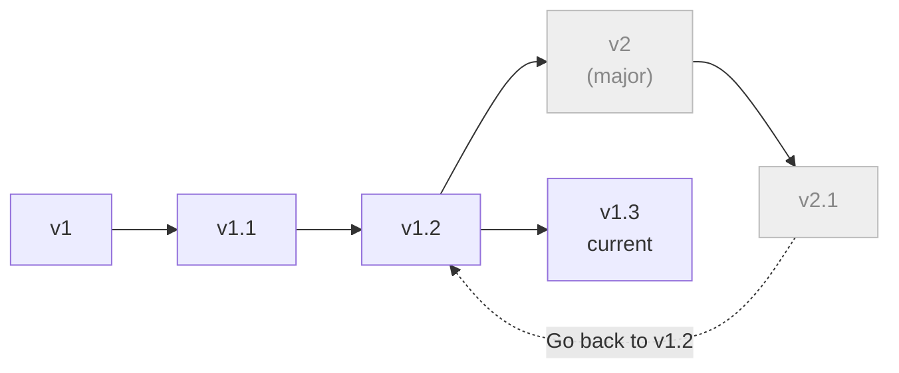
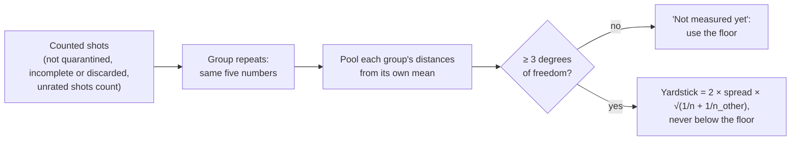

# Recipes and versions

A **Recipe** is how you dial in one bean: the bean, the grinder, a profile that belongs to that Recipe alone, and the numbers on top. Every change is a new version that can carry a prediction, and the Recipe page is a log of experiments with one number above it that matters: "6 of 10 predictions held".

## What a version is

| Part | What it holds | When it can change |
|---|---|---|
| **The numbers** | Profile version, grind (text and number), dose, target yield | Never: written once; a change is a new version |
| **Drink and drink notes** | Espresso, Americano, Cappuccino, Latte or Other, plus how the drink is made | Inherited like the numbers; not part of what counts as a repeat; a different drink suggests a major version |
| **Prediction** | What the version is expected to do, compared with which version | Only before its first shot and before an outcome is recorded |
| **Outcome** | Held, partly held, failed or inconclusive, with a line why | Once there is a prediction and a rated, non-discarded shot; can be changed or cleared for ever after |

**There is no brew temperature among the numbers.** The machine heats to what the profile says, so a number typed on a Recipe would be a claim about a document it does not control. The temperature is read from the profile wherever it is shown, and changing it means changing the profile. When a version moves to a profile version with a different temperature, the log shows "Temperature 93 → 94 °C" beside the profile change.

The drink shows as a badge on the Recipe's card, beside its name on its page and on every version of the log, and the notes under the page's heading. **Change something** starts those two fields filled with the current version's, so that clearing the notes can remove them; only what you change is recorded, and another drink ticks **Major change** for you to keep or untick. A drink once stated cannot be unset. The shots table has a Drink column, off until you switch it on.

**Change something** shows no profile to choose, except for a Recipe that has none (one being designed, or an old one that never named a profile), which takes a profile no Recipe has.

**Why a prediction locks.** A guess typed once the cup has been tasted is a memory, and a track record built from memories measures nothing. A guess rewritten under a grade would leave the grade attached to something nobody predicted. The window is honest rather than airtight (unfiling every shot and clearing the grade opens it again): it guards against writing a prediction after the fact, not against someone setting out to fool themselves. The rule lives in the repository, beside the other cross-table rules, so the refusal reaches the page as a sentence rather than a constraint failure.

## Names, the current version and going back

- **Names are tags, not positions.** Dialling in (grind, dose, yield, a profile tweak such as a degree) is a **minor** version (v1.2 → v1.3); a functional change to what the profile does is a **major** one (v1.2 → v2). The **Major change** box decides, and each button names the version it will record ("Accept as v1.3"). A minor is numbered from the current version's major, so after going back to v1.2 the next is v1.3 (or the next free minor).
- **Go back to this version** puts the Recipe back on that version as it was: nothing new is recorded, its prediction, shots and outcome stay, and new shots file under it. The Recipe's profile goes back to what that version brews, and the next sync with Writes on puts it on the machine.
- **Dead ends.** The live line is walked backwards from the current version through the version each was made from, as in version control. Everything it does not pass through is a dead end, muted but fully readable. Stated as a walk, not as "the span between a revert and its target", because those stop agreeing the moment reverts overlap.
- When the current version has Bad shots and no Good one, the page offers the way back to the nearest version behind it that has a Good shot.

After going back, the next major is the highest major in the Recipe plus one (so from v2.1 back to v1.2, a major is v3), while the next minor continues from the version you went back to (v1.3).

## A Recipe follows its profile

A Recipe has exactly one profile, for good. Whenever that profile gets a new active version (a proposal approved, **Make active** on the Profiles page, the machine's side kept after an edit there), the Recipe records a new minor version naming it, in the same step. That is also what keeps the next shots landing in this Recipe, since a shot joins the one Recipe that brews its profile. Several Recipes can collect shots at once, which is how two beans on two grinders both collect. To try a bean on a copy of a Recipe's profile, **Duplicate Recipe**.

The Recipes page explains this in **How a Recipe works**, open while no Recipe is being dialled in.

**Archiving** a Recipe (the bean is finished) takes everything it has off the machine in one transaction: its pins are unpinned and its profile's "On the machine" switch goes off, so the next sync with Writes on removes the files. Unarchiving switches the profile on again and files the next shots; shots that arrived meanwhile stay in the inbox.

## The spread: how much the shots vary anyway

Above the log: "Shot time ±1.8 s · from 9 repeat shots at 3 settings". It is the yardstick every comparison on the page is held against, and the app computes it; no model is involved.

- **Pooled within repeats**, not over all the Recipe's shots: a Recipe's shots are *meant* to differ, and that figure would grow every time a change worked.
- **Eight measures**, each only where the archive holds it: shot time, first drip, first puck flow, yield, peak pressure, cup flow, puck flow, rating. A shot with no scale has no cup measures, and a cup measure is never pooled with a puck one.
- **Floors** until measured: 2 s shot time, 1 s first drip, 1 g yield, 0.3 bar peak pressure, 0.2 g/s cup flow, 0.2 ml/s puck flow, half a star.
- A difference and its yardstick are shown one decimal finer than the means, so a row can never read "+2.0 s, beyond 2.0 s"; the comparison is made on unrounded values, so the display can never decide a grade.
- The arithmetic is pure and tested by hand-computed cases (a grade has to be something a person can redo on paper), and it sums in a fixed order because floating-point addition is not associative.

Each predicted version carries an **Evidence** disclosure: all its counted shots against all of the compared version's, measure by measure, *beyond the spread* or *inside it*.

Three degrees of freedom means four shots pulled with one set of numbers, or two settings with three shots and two, since each group spends one degree on its own average.

A group of one shot contributes nothing, since a single shot has no distance from itself; shots filed under a version after you went back to it count as repeats of its earlier shots.

First drip is when coffee first reached the cup, read from the scale; first puck flow is the pump model's estimate, which every shot with a pressure sensor has.

The yield measure is the one typed into the judgement if there is one, then the machine's final weight, then the volume its own index recorded (the same order the starting-point wizard scores a version by), because a machine with no scale records nothing and the only yield that exists is the one written down.

A measure the machine or scale records nothing for is left off the block rather than carried as an empty line, and so is a value the archive wrote as zero to mean "there was nothing to average".

A difference exactly the size of its yardstick counts as inside it.

Under the Evidence table sit the balance counts and the Good / Neutral / Bad / not rated counts for both sides, as plain facts with no verdict on them; the disclosure is closed unless the prediction is still ungraded and there are shots to grade it with, and none of it appears on the shot page, which shows the prediction and not a table of what the version has been doing.

## Ratings, in words

The stars are the judgement: yours, then the machine's notes card, then the machine's index. Where shots are counted they are read as **Good** (4–5), **Neutral** (3) or **Bad** (1–2); these are never stored, only worked out. **Discard** ("this shot went wrong, do not count it") is independent of the stars, and every count leaves a discarded shot out first.

No rating, or a rating of 0, is none. The stars are coloured by the same bands (green for Good, grey for Neutral, amber for Bad).

The counts, the gold standard (the Good shots), what a prediction can be graded on (any rated shot that is not discarded), the way back to a version that worked (one with a Good shot) and the agent's shot search all read a shot this way, and all leave a discarded shot out first.

## Starting a Recipe

| Path | What it does |
|---|---|
| **New Recipe** form | Name, bean, grinder, a profile no Recipe has (picking one that has a Recipe duplicates it), numbers, drink; the yield fills from the profile's largest volumetric stop |
| **Suggest a starting point** | Shows what this archive has brewed on *this grinder* that resembles the bean (one SQL query, free), then optionally asks a model for three options; accepting one creates the Recipe and a profile draft |
| **Design with the agent** | A Recipe whose version 1 has no numbers yet; its conversation proposes the whole first version as one card. See [Chat and proposals](chat-and-proposals.md) |
