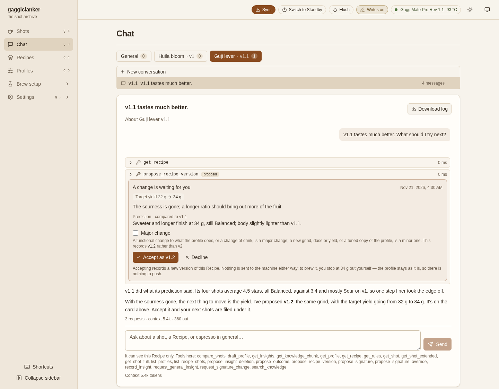

# Review and chat

## LLM settings

*How this works: [Language models](language-models.md).*

A review, the chat, profile drafts, starting points and Find patterns all go through one provider. Choose it under **Settings → LLM** (`llmProvider`).

| Provider | Pick it when | Credential |
| --- | --- | --- |
| `claude_code` (default) | You have a Claude subscription. There is no API key to buy. | `claudeCodeOauthToken` |
| `anthropic` | You have an Anthropic API key. | `anthropicApiKey` |
| `openai`, `openrouter`, `ollama`, `lmstudio` | You use that service, or a model on your own machine. | `llmApiKey` |
| `openai_compatible` | Any other OpenAI-compatible gateway. | `llmApiKey` and `llmBaseUrl` |

Paste the credential under **Settings → LLM**. It is kept in the database only and is never read from the environment. Each provider has its own, and none is lent to another.

For `claude_code`, run `claude setup-token` on any machine that has the Claude CLI and paste the token. An interactive `claude login` is not enough. A source checkout needs the CLI installed (`npm install -g @anthropic-ai/claude-code`) or `claudeCodeBin` pointed at it. The Claude Code panel under **Settings → LLM** can install a newer release (`stable`, `latest` or an exact version) without rebuilding. **Use the image's version** removes it. Nothing updates on its own.

**Validate credentials** tests what the form holds before you save it.

| Setting | What it does |
| --- | --- |
| `modelDefault` | The default model. Per-kind overrides are `modelReview`, `modelDraft`, `modelChat`, `modelStartingPoint` and `modelPatterns`. An empty value lets the provider choose. |
| `llmTimeoutSeconds` | Bounds one attempt. |
| `llmRateLimitRetries` | When the provider throttles the account, every model call stops. A button in **Settings → LLM** starts them again. |

## The review

*How this works: [Shot checks and review](shot-checks-and-review.md).*

A **review** is a model's look at one shot. It starts only when you click **Review**, in the shots table or on the shot page. Nothing else starts one, and a discarded or unparsed shot cannot be reviewed.
It writes **claims**, and nothing else about the cup: no taste prediction, no advice. Each claim covers a window of the shot, may carry a fault word, and has one sentence. **The numbers beside a claim are measured by the app**, never typed by the model. A claim the numbers do not bear out is kept and marked. The review also answers each free-text expectation of the profile's signature, and says how the shot moved against the Recipe version's prediction when there is one.

**Each claim is kept unless you reject it.**

| Control | What it does |
| --- | --- |
| **Reject** | Takes a claim off the list and out of the chat. |
| **Restore** | Puts it back. It sits behind "N rejected · show". |
| **Review again** | Asks once, then replaces the current review. Only the newest finished review can be answered. |

The **AI Review** column shows what the model wrote. The **Curve check** column next to it is separate: the app computes it from the numbers on every shot, and a review never changes it.

| AI Review badge | Meaning |
| --- | --- |
| **Review** button | Not reviewed yet. |
| `Reviewing…` | A review is running. |
| `ramp: early yield +1` (red or amber) | The first fault as `phase: fault`, plus the count of the others. Rejected claims and claims the numbers do not bear out are not counted. |
| `As intended` (green) | The profile has a signature in force and no fault was found. |
| `No faults` (grey) | No fault was found, and there is no signature to check against. |
| `Failed to run` (grey) | The call failed. Press **Retry**. |

The chat is told every claim you did not reject, never the review's summary. A review is never on its own a reason to change a Recipe. The rules it draws on are on the **Knowledge** page, where you can edit or switch them off. They are adapted from [gaggimate-barista](https://github.com/chall-tech/gaggimate-barista) (MIT).

**When a review fails**, it is kept with the provider's error code, and the badge reads `Failed to run`. A review cut off by a restart is marked `interrupted` at the next start.

## The chat

*How this works: [Chat and proposals](chat-and-proposals.md).*

The **Chat** page (`g c`) is a conversation with an agent that asks the archive its own questions. Above the conversation is a row of badges: **General**, then each Recipe you have not archived. Click a badge to list its conversations. **Show archived Recipes** adds the archived ones.

| Kind | How to open it | What it can read |
| --- | --- | --- |
| **Recipe** | **New conversation** under a Recipe's badge, **Discuss in chat** on the Recipe, the **Chat** link in its experiment log, or the Recipe's button in the **Chat about** bar above the shots table. The last three open it with a question already typed. | That Recipe only, at one version: its versions, predictions, outcomes, shots, spread, the knowledge base and the insights you added. |
| **General** | The **General** badge. | The whole archive, read-only, across Recipes. |
| **Design** | **New Recipe**, then **Design it with the agent** (see below). | The Recipe being designed, your profiles, the knowledge base, and how this bean went in your other Recipes. |

A Recipe conversation is about one version. **New conversation** starts on the current version and stays on it, so the list reads as a history of what was argued.

**The agent only proposes.** Every change is a card, and nothing changes until you answer it. It cannot touch the machine. A General conversation cannot change a Recipe, and tells you which badge to open. The agent also cannot dodge the Recipe's rules:

* A change needs a prediction.
* A change that moves two things at once needs a reason they cannot be separated.
* It cannot propose the next change while the current version's prediction is ungraded.
* Only one proposal waits at a time.

A waiting proposal is retired unanswered when you change the Recipe another way, for example by recording a version on the form or going back to an older version.

| Card | Buttons | What happens |
| --- | --- | --- |
| Next version | **Accept**, **Decline** | Accept records the next version with its prediction. Nothing is sent to the machine, and the card says what to do next. Decline creates nothing, and your note is what the next conversation is told. |
| Outcome | **Accept**, **Record another outcome**, **Dismiss** | See [Shots and Recipes](shots-and-recipes.md#the-experiment-log). |
| Profile draft | **Approve**, or **Make active** on the Profiles page | In a Recipe conversation it carries a prediction. Making it active records the new version too. |
| First version (design) | **Accept**, **Decline**, **Accept and sync** | See *Designing a Recipe with the agent*. |
| Insight | **Add**, **Dismiss** | Add makes it count. Dismiss drops it. |
| Replace an insight | **Add** | Adds the new text and deletes the old insight in one step. |
| Delete an insight | **Delete**, **Keep** | The insight stays until you press Delete. |
| Find patterns proposal | **Approve**, **Dismiss** | See below. |

Accept and Decline on a card tell the agent. After an Accept it sends you to a new conversation for the new version.

**Insights.** What the agent learns in a Recipe conversation is stored with that Recipe and version. It shows as a card in the chat and is listed on the Recipe page, where added ones have **Take back**. Only an added insight is told to that Recipe's later conversations, and to no other Recipe's. Nothing expires by itself: only you remove an added insight. The **Knowledge** page holds general insights, which you write by hand or add from an agent's request.

**Find patterns** (Knowledge page, Insights tab) reads the added insights of every Recipe and proposes general ones that several Recipes say in different words. It runs only when you press the button, and only once two Recipes have an insight. Approve writes the general insight and deletes the Recipe insights it came from. Dismiss keeps the proposal, so the next run knows you declined it.

**Keep a conversation.** **Download log** in the conversation's header saves it as one JSON file. **Stop** cancels an answer mid-run. **Settings → Shot information** chooses what the agent is told about each shot.

## A starting point for a new coffee

1. Open **New Recipe** and pick the bean and the grinder.
2. Open **Suggest a starting point instead**, folded under the form. It shows what this archive has brewed on this grinder that resembles the bean (same roast, process and origin): shots, mean rating, ratio and time. This step is free and uses no model.
3. Press **Ask for suggestions**. The model gives three complete first versions: conservative, recommended and adventurous. Each has a grind, dose, yield, temperature, profile and a rationale.
4. Take one. It creates the Recipe. When the option needs a profile of its own, or a temperature its profile does not brew at, a draft waits on the **Profiles** page. Make it active yourself. Nothing is sent to the machine until then.

A grind number appears only when your usual setting or a past Recipe on the same grinder anchors it. Otherwise the grind is relative, and the card says so. Step 3 needs an LLM provider.

## Designing a Recipe with the agent

Use this for a new profile rather than a first guess.

1. Open **New Recipe** and fill in the name, bean and grinder. The grinder is required. Pick a profile to fork if you want one. Any grind, dose or yield you fill in is kept as your decision.
2. Open **Design it with the agent**, folded under the form. Enter your usual grind on that grinder and what you want from the coffee.
3. Press **Start designing**. It opens version 1's conversation with your wishes as the first message.
4. Answer the agent's questions. It proposes the whole first version as one card: a profile of its own, the grind, the dose and the yield.
5. **Accept** the card, in the conversation or on the Recipe page. It becomes version 1 and the design ends. The card's profile is approved and switched on. With Writes on, **Accept and sync** starts the sync that puts it on the machine. With Writes off, **Accept** leaves it for the first sync after you turn Writes on.
6. Select the profile on the machine. Shots brewed on it are filed under the new Recipe. Talk those shots through in a new conversation.

Until you accept, the Recipe shows a **Designing** badge, with **Continue designing** back into the conversation. **Discard design** deletes a design nobody brewed under. A design needs an LLM provider.

## The chat's database tool (MCP)

*How this works: [Chat and proposals](chat-and-proposals.md#the-chats-database-tool-over-mcp).*

The `claude_code` provider runs the chat's tool loop inside the Claude Code CLI, and the CLI reaches tools only through an MCP server. So for each chat turn the app starts `gaggiclanker mcp` as a child process over stdio, on the same `DATA_DIR`, and the agent gets the same tools it has with any other provider. This server is internal to the chat, not a connection for another client. It opens the database and nothing else: no network endpoint, no machine connection. It only reads the archive or proposes something a person answers. The command never creates the database, so the app must have started once.
