# Shot checks and review

A shot is judged in three places, kept apart on purpose: **your judgement** (stars, balance, taste notes, discard), the **Curve check** (deterministic, computed by the app on every shot), and the **AI Review** (a model's claims about one shot, made only when you ask). The shots table shows the last two as separate columns because they answer different questions: "did the curve do what the profile is for?" and "what does a model see in it?".

```mermaid
flowchart TB
  SHOT["A stored shot:<br/>samples, phases, metrics"] --> W["Universal warnings<br/>(e.g. yield vs target, fast flow)"]
  PROF["Its profile version's<br/>signature in force"] --> EXP["Expectations per phase<br/>(critical / important / context)"]
  W & EXP --> CC["Curve check column<br/>computed whenever the shot is read"]
  SHOT --> RV["AI Review (on a click)"]
  EXP -- "free-text expectations" --> RV
  RV --> CL["Claims, each with evidence<br/>the server evaluates"]
  CL --> AIR["AI Review column<br/>(claims you did not reject,<br/>borne out by the numbers)"]
  CL --> CHAT["What the chat is told"]
```

## The Curve check

Worked out every time a shot is read, from its stored numbers, where it is filed, and its profile version's **signature** in force. No click, no model, and a review never changes it. Refiling a shot changes it, because the target yield it is held against comes from the Recipe version.

| Badge | Meaning |
|---|---|
| `ramp: early yield +1` (red / amber) | The first entry's phase and fault, coloured by its severity, plus the count of the others |
| `Pass` (green) | The profile has a signature in force, at least one expectation was measured, none failed |
| `Unchecked` (grey) | No signature in force and no warning, or a signature whose checks measured nothing |

**Signatures say what a profile is for.** An agent proposes a signature for a profile version: expectations per phase, each critical, important or context, written in a small metric language (for example, the cup is not full before the decline). It is **in force at once**, and a person rejects or restores each expectation on the Profiles and Recipe pages. It is carried to the profile's next version and stays in force; a carried expectation whose phase no longer exists is shown and never in force. Only an expectation in force is ever a check, a badge or an agent's input. With a signature, a turbo profile's fast flow reads grey ("as expected") instead of as a fault.

**There is no score and no grade on any number.** Warnings are facts to weigh against what the profile is for, never a verdict on their own.

## The AI Review

One structured model call about one shot, started only by **Review** on the shots table or the shot page. No chat tool, batch, timer or sync step starts one, and a discarded or unparsed shot is never reviewed.

| The model is given | The model is never given |
|---|---|
| The shot's own information, checks first | Your judgement, the note typed on the machine, your label |
| The Recipe version's numbers and prediction | Any other shot |
| The signature's free-text expectations in force | An earlier review |
| The profile the shot brewed, the detected shot style | A conversation |
| The knowledge rules and reference passages its telemetry selects | |

**It writes claims, and nothing else about the cup.** No taste prediction, no advice, no proposal. Each claim is tied to a window of the shot (a phase, a span, or the whole shot, so the curve can highlight it), carries an optional fault word from a fixed list, one sentence with no figures in it, and one to three metric-language expressions. **The numbers are the server's**: it evaluates every expression on the shot and stores the value and whether the comparison held. A figure beside a claim is one the app computed, never one the model typed. A claim the numbers do not bear out is kept, marked, and left out of the badge. The review also answers each free-text expectation, says how the shot moved against the version's prediction, and gives you a one-sentence summary.

**Each claim is kept unless you reject it.** There is nothing to confirm: **Reject** takes a claim off the list and out of the chat, **Restore** puts it back. The review in force is the shot's newest *finished* review; a newer one that is running, failed or interrupted only changes the badge's words until it finishes. **Review again** asks once before replacing the current review.

**What the chat is told** is every claim you did not reject, with its numbers, and the prediction stance. The summary never is. One filter does this for every surface that reads claims, and the SQL view `v_review_claims` filters it too, so a query cannot read what a person rejected. Both the glossary and the chat's rules say a review is weighed below the measured numbers and your judgement, and never on its own a reason to change a Recipe.

## Running and failing

The call runs as a background task: pressing **Review** answers at once with a `running` row, and the page follows `review.started`, `review.finished`, `review.failed` and `review.answered` on the event stream, so another tab follows too. Pressing it twice gets the same run back, and the database allows one running review per shot. A provider failure is a stored row with the provider's error code; a review cut off by a restart is marked `interrupted` at the next boot. Neither leaves a spinner nobody can clear.

## Decisions

**Two columns, because they are two jobs.** Merging a model's reading into the deterministic check would let a model's sentence move a badge the app computed from numbers. Keeping them apart means the Curve check is the same on every reload and the review is visibly a second opinion.

**Claims with the app's numbers, not a paragraph.** The review used to be a blind taste prediction, a paragraph and a summary. It was replaced by claims tied to windows of the shot, whose evidence the server evaluates, so no number beside a claim was typed by the model; taste stays yours, and the output has no field for a prediction, advice or a proposal.

**In force until rejected, not waiting for a confirm.** Signatures used to wait for **Confirm** on each expectation, so a freshly designed profile had no checks until someone clicked through them. Signatures and review claims are now in force the moment they are written, and a person rejects what they disagree with; the agent cannot put back an expectation you rejected.
