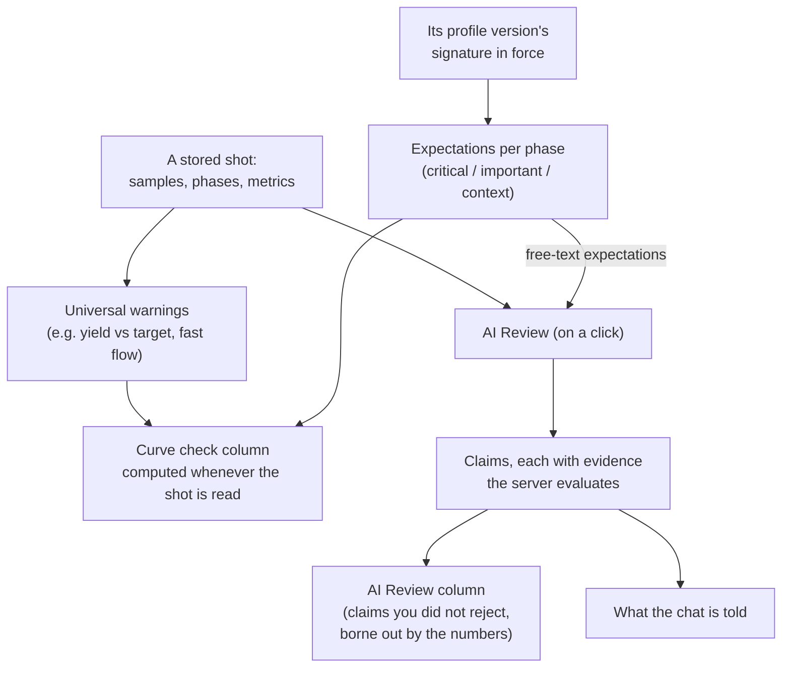

# Shot checks and review

A shot is judged in three places, kept apart on purpose: **your judgement** (stars, balance, taste notes, discard), the **Curve check** (deterministic, computed by the app on every shot), and the **AI Review** (a model's claims about one shot, made only when you ask). The shots table shows the last two as separate columns because they answer different questions: "did the curve do what the profile is for?" and "what does a model see in it?".

A row of the shots table opens in place with the shot page's judgement and curves boxes, laid out as on the page: the full judgement across the top (saved with its button, the notes in its right-hand column) and the curves with their toggles and downloads on a row of their own below it.

A first visit shows the columns Recipe, Time, Duration, Yield, Curve check, Rating, Balance, Discard and AI Review; Profile, Notes, Curve, Drink and Flags are in the column chooser, and a layout you chose is kept as you made it. The optional Curve column has a button in its heading that chooses which of the nine series it draws (pressure and cup flow by default; a shot with no scale draws pressure alone) and in which theme colour, remembered per browser. The Recipe column can be dragged narrower.

The Rating column is the stars, coloured by their band. The Balance column is filled for your verdict and outlined for the machine's notes card. The Discard column is an outlined Discard button that then reads Discarded, and a click clears it (the judgement form has the same as a "Discard this shot" switch). **Hide discarded** (ticked by default, on the line under the buttons, remembered in this browser) leaves discarded shots out of the list.

The filters narrow by date, profile, Recipe, rating, source and readability. A Recipe's experiment log links each version's shot count to *that version's* shots, and the filter says which version is on and removes it in one click. A shot's page names its profile as it is called now, linked, and says what the machine called it when the shot was brewed ("brewed as") when that was another name.

Above the table, **Chat about** has one button per Recipe you are brewing (not archived, not being designed), labelled with its current version: it opens or continues that version's conversation with a question already typed.

## The Curve check

Worked out every time a shot is read, from its stored numbers, where it is filed, and its profile version's **signature** in force. No click, no model, and a review never changes it. Refiling a shot changes it, because the target yield it is held against comes from the Recipe version.

| Badge | Meaning |
|---|---|
| `ramp: early yield +1` (red / amber) | The first entry's phase and fault, coloured by its severity, plus the count of the others |
| `Pass` (green) | The profile has a signature in force, at least one expectation was measured, none failed |
| `Unchecked` (grey) | No signature in force and no warning, or a signature whose checks measured nothing |

**Signatures say what a profile is for.** An agent proposes a signature for a profile version: expectations per phase, each critical, important or context, written in a small metric language (for example, the cup is not full before the decline). It is **in force at once**, and a person rejects or restores each expectation on the Profiles and Recipe pages. It is carried to the profile's next version and stays in force; a carried expectation whose phase no longer exists is shown and never in force. Only an expectation in force is ever a check, a badge or an agent's input. With a signature, a turbo profile's fast flow reads grey ("as expected") instead of as a fault.

**There is no score and no grade on any number.** Warnings are facts to weigh against what the profile is for, never a verdict on their own.

The universal warnings are four: over target (the final weight is above 110 % of the target yield of the version the shot is filed under), under target (below 90 %), a phase of its profile skipped because the shot stopped on weight, and fast flow (the cup flow over 3 g/s for a second at 80 % of the peak pressure; a turbo profile does it on purpose).

The Curve check column's colour is the first entry's severity and it sorts by it; with no entry, a green `Pass` and then a grey `Unchecked` sort after the entries, in that order.

A free-text expectation is not part of the Curve check ("checked by the review"), and the Curve check box on the shot page is always there: with nothing to list it says one plain line.

## The AI Review

One structured model call about one shot, started only by **Review** on the shots table or the shot page. No chat tool, batch, timer or sync step starts one, and a discarded or unparsed shot is never reviewed.

| The model is given | The model is never given |
|---|---|
| The shot's own information, checks first | Your judgement, the note typed on the machine, your label |
| The Recipe version's numbers and prediction | Any other shot |
| The signature's free-text expectations in force | An earlier review |
| The profile the shot brewed, the detected shot style | A conversation |
| The knowledge rules and reference passages its telemetry selects | |

**It writes claims, and nothing else about the cup.** No taste prediction, no advice, no proposal. Each claim is tied to a window of the shot (a phase, a span, or the whole shot, so the curve can highlight it), carries an optional fault word from a fixed list, one sentence with no figures in it, and one to three metric-language expressions. **The numbers are the server's**: it evaluates every expression on the shot and stores the value and whether the comparison held. A figure beside a claim is one the app computed, never one the model typed. A claim the numbers do not bear out is kept, marked, and left out of the badge. The review also answers each free-text expectation, says how the shot moved against the version's prediction, and gives you a one-sentence summary.

**Each claim is kept unless you reject it.** There is nothing to confirm: **Reject** takes a claim off the list and out of the chat, **Restore** puts it back. The review in force is the shot's newest *finished* review; a newer one that is running, failed or interrupted only changes the badge's words until it finishes. **Review again** asks once before replacing the current review.

**What the chat is told** is every claim you did not reject, with its numbers, and the prediction stance. The summary never is. One filter does this for every surface that reads claims, and the SQL view `v_review_claims` filters it too, so a query cannot read what a person rejected. Both the glossary and the chat's rules say a review is weighed below the measured numbers and your judgement, and never on its own a reason to change a Recipe.

The numbers behind a claim are the ones `POST /api/shots/{id}/evaluate` gives for the same expression, and each stores the value, the unit, the kind of channel and whether the expression's own comparison held.

A claim whose evidence could not be measured at all is kept and marked like one whose comparison failed.

The review's stance on the version's prediction is one of as predicted, partly, against or not shown, and it is shown like any claim.

A finished review sets the previous one aside, rejected claims included.

The AI Review column is built by code from the claims you did not reject and whose numbers bear them out: a failed free-text expectation (red for critical, amber for important) or a claim with a fault word (amber) gives a `phase: fault +N` entry, and a claim the numbers do not bear out stays in the Review box and in what the chat is told, but not in the badge or its "+N". With no fault it is a green `As intended` (a signature is in force) or a grey `No faults`, and it is empty for a shot nobody can review.

The AI Review column sorts faults first, then `Failed to run`, `Reviewing…`, `No faults`, shots not reviewed yet, `As intended`, and last the shots nobody can review.

Pressing a reviewed badge opens the row with its Review box expanded.

The shot page and the open row draw the same boxes in the same order: Your judgement (open), the version's prediction (it does not fold), Curves, Review and Curve check (folded). Each box's state is remembered per browser; pinning a claim opens Curves, and a Curve check line for a free-text expectation opens Review at its answer.

The **Review** group of the shot catalogue (three items, all base) says whether a shot was reviewed and how many claims were kept or rejected, lists the kept claims (free-text answers among them) with the numbers behind them, and says how the shot moved against its prediction.

The SQL tool's `v_review_claims` holds the claims of a shot's newest finished review that were not rejected, and `v_reviews` only counts.

The knowledge rules are on the **Knowledge** page: a small tier of dial-in heuristics (temperature by roast, the pressure matrix by roast and process, ratio and time by style, taste → suspect, telemetry → cause), each with its source and confidence, each editable, each with a switch.

The rules are adapted from [gaggimate-barista](https://github.com/chall-tech/gaggimate-barista) (Charlie Hall, MIT) by way of gaggimate-mcp; the attribution is in the seed file.

## Running and failing

The call runs as a background task: pressing **Review** answers at once with a `running` row, and the page follows `review.started`, `review.finished`, `review.failed` and `review.answered` on the event stream, so another tab follows too. Pressing it twice gets the same run back, and the database allows one running review per shot. A provider failure is a stored row with the provider's error code; a review cut off by a restart is marked `interrupted` at the next boot. Neither leaves a spinner nobody can clear.

## Decisions

**Two columns, because they are two jobs.** Merging a model's reading into the deterministic check would let a model's sentence move a badge the app computed from numbers. Keeping them apart means the Curve check is the same on every reload and the review is visibly a second opinion.

**Claims with the app's numbers, not a paragraph.** The review used to be a blind taste prediction, a paragraph and a summary. It was replaced by claims tied to windows of the shot, whose evidence the server evaluates, so no number beside a claim was typed by the model; taste stays yours, and the output has no field for a prediction, advice or a proposal.

**In force until rejected, not waiting for a confirm.** Signatures used to wait for **Confirm** on each expectation, so a freshly designed profile had no checks until someone clicked through them. Signatures and review claims are now in force the moment they are written, and a person rejects what they disagree with; the agent cannot put back an expectation you rejected.
