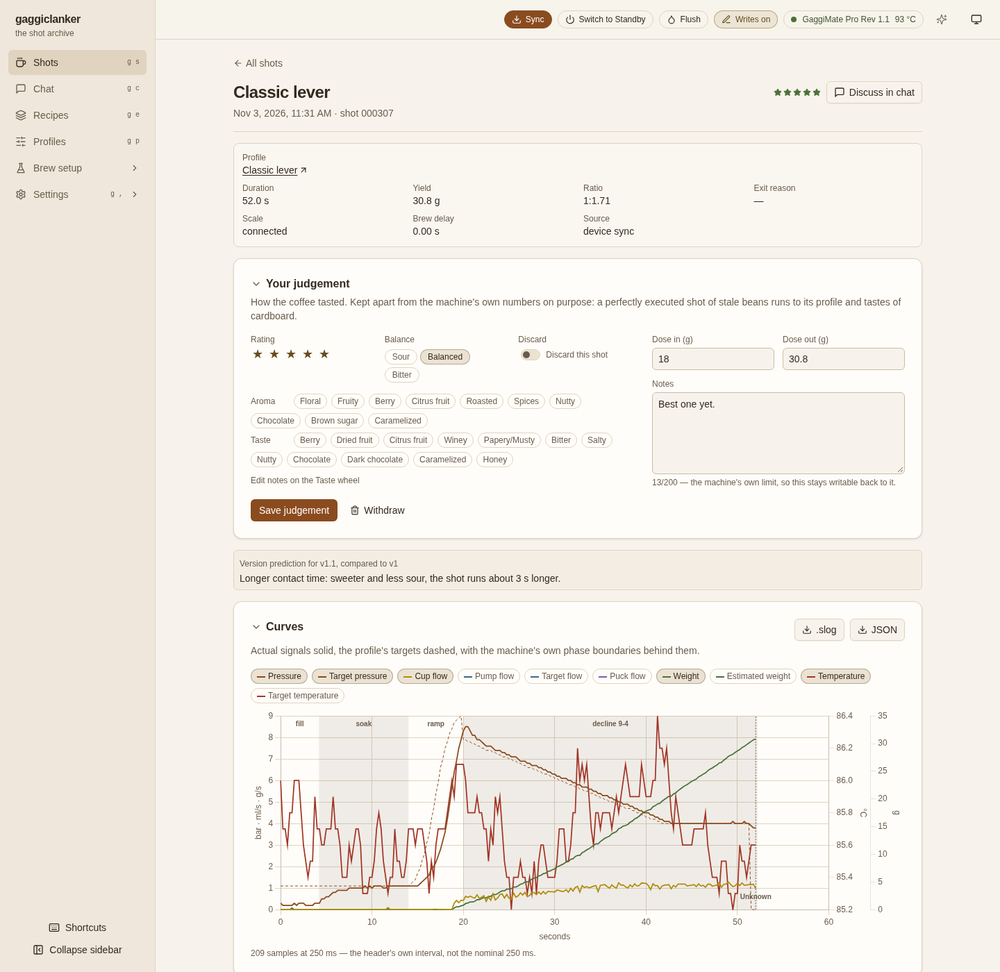
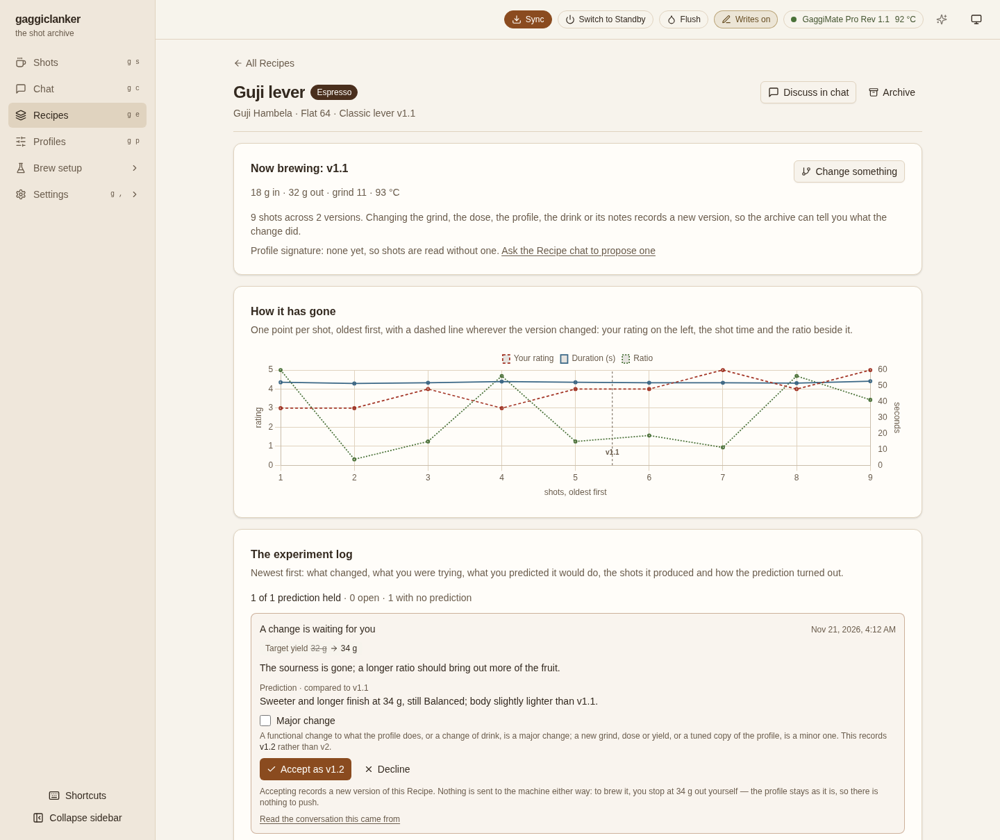

# Shots and Recipes

## The pages

*How this works: [Sync and the archive](sync-and-the-archive.md), [Shot checks and review](shot-checks-and-review.md).*

The sidebar has Shots, Chat, Recipes, Profiles, **Brew setup** (Beans, Hardware, Taste wheel) and **Settings**. Press `g` then the letter below to jump to a page, or `[` to fold the sidebar. The machine status in the top bar opens the Device page.

| Page | `g` | What it is |
| --- | --- | --- |
| **Shots** | `g s` | The archive: every shot with its curve, diagnostics and your judgement. |
| **Chat** | `g c` | The tool-using conversation, with a badge per Recipe. **New** on a badge starts one about that Recipe. |
| **Recipes** | `g e` | How you dial in one bean, as versioned numbers on a profile that belongs to the Recipe alone. Archive one when its bean is finished: it then comes off the machine at the next sync with Writes on. |
| **Profiles** | `g p` | Every profile you have had, with **On the machine** and **Starred** switches. See [Profiles and the machine](profiles.md). |
| **Beans** | `g b` | The coffees you brew. Each exports as JSON, and **Import JSON** reads one back. |
| **Hardware** | `g h` | The machine and the grinders. |
| **Taste wheel** | `g w` | The SCA/WCR Flavor Wheel. Pick which notes the shot panel offers. |
| **Settings** | `g ,` | Collapsible cards: Machine access and LLM first, then Authentication, Prompts, Profile safety, System and Import. |
| **Knowledge** | `g k` | Under Settings. The dial-in rules, prose documents and your **general** insights. A Recipe's own insights live on its page. |
| **Device** | | The machine's versions and connection, what each sync pass did and every write attempted, refused ones included. |

**The shots list.** Click a row to open it in place, with the judgement and the curves. Rating is the stars. Balance shows Sour, Balanced or Bitter: filled is your verdict, outlined is the machine's notes card. **Discard**, a button on the row or a switch in the judgement, means "this shot went wrong, do not count it". **Hide discarded** is on by default. Filters narrow by date, profile, Recipe, rating, source and readability, and the column chooser adds more columns. A Recipe's log links each version's shot count to that version's shots. The import drop zone is on this page.

A new shot is filed under the live Recipe that brews its profile. With none, it waits in the "needs a Recipe" inbox, and **Match by profile** files the waiting ones. **Chat about**, above the table, has one button per Recipe you are brewing. It opens that version's conversation with a question already typed, so you only press Enter.

## The experiment log

*How this works: [Recipes and versions](recipes-and-versions.md).*

A Recipe page is a record of experiments, one per version. A version's numbers are the **profile** version, the grind (text and number), the dose and the target yield. Each version also says what changed and what you were trying. Optionally it says what you **predicted** it would do, and compared to which version.

A Recipe has one profile and follows it. Whenever the profile gets a new active version (you approve a change, press **Make active**, or keep the machine's side after an edit there), the Recipe records a new minor version naming it, in the same step. Making an older Recipe version current makes its profile version active without adding a version. **Change something** has no profile to choose. To try a bean on a copy of the profile, use **Duplicate Recipe**.

**A version also says what it is for: its drink and drink notes.** The drink is what is added after the shot leaves the portafilter: Espresso, Americano, Cappuccino, Latte or Other. The notes say how it is made. Each new version keeps both until you change them. A drink, once stated, cannot be unset, and no drink stated is not Espresso. Another drink ticks **Major change** for you to keep or untick. The drink does not affect what counts as a repeat.

**There is no brew temperature to type.** The machine heats to what the profile says, and the forms show it read-only. To change it, change the profile.

Once the shots are in and you have rated them, record the **outcome**: held, partly held, failed or inconclusive, with a line saying why. Above the log sits the only number that matters, "6 of 10 predictions held". You can change or clear an outcome whenever you like.

**Versions are named v1, v1.1, v1.2, v2.** Dialling in (grind, dose, yield, or a parameter such as a degree of temperature) is a **minor** version: v1.2 → v1.3. A functional change to what the profile does is a **major** one: v1.2 → v2. You decide with the **Major change** box, on the Add a version form and on a change card. It starts off, and the buttons name what they will record ("Accept as v1.3"). The agent may suggest major, but the box is yours.

Two rules keep the track record honest:

* **A prediction can only be written before the version's first shot**, and before its outcome has been recorded. After either, the app refuses it and says which.
* **The prediction is always shown.** On the shot page and in the shots list's panel, a shot whose version predicted something shows the words, with nothing to click first.

**The agent can propose the outcome for you to accept.** It appears as a card in the chat:

| Button | What it does |
| --- | --- |
| **Accept** | Records the outcome as written. |
| **Record another outcome** | Records your own choice of the four. |
| **Dismiss** | Records nothing, and may say why. |

Nothing is recorded until you press one. If the same answer also proposes the next version, accepting it records a waiting grade first, as long as the outcome is still open. If you dismissed the grade, the version cannot be accepted until you have graded it.

Versions are listed newest first, with the one the Recipe is on marked **current**. **Go back to this version** puts the Recipe back on it, as it was. Its prediction, shots and outcome stay, and new shots are filed under it. The log gets a line such as "Went back to v1.2 (from v2.1)".

**Going back changes the machine, by the usual route.** The profile goes back to what that version brews, and the next sync puts it there if the profile is on and Writes is on.

When the current version has Bad shots and no Good one, the page offers the way back to the nearest version that has a Good shot. Each version's shot count links to the shots list narrowed to that version. Versions off the line you are now brewing are marked **dead ends** and muted, but stay readable.

## The spread: how much your shots vary anyway

*How this works: [Recipes and versions](recipes-and-versions.md#the-spread-how-much-the-shots-vary-anyway).*

Above the log, the Recipe page says how much its shots differ **when nothing in the version's numbers changed**: "Shot time ±1.8 s · from 9 repeat shots at 3 settings". Repeat shots share the same profile version, grind, dose and target yield. Every comparison on the page is held against this figure. "31 s against 34 s" means nothing until you know whether three seconds is a lot for this grinder, this basket and this bag. The app works it out, and no model is involved.

Until there are enough repeat shots (about four at one setting), the line says "not measured yet" and uses a conservative floor instead.

Where shots are counted, the rating is read in words:

| Words | Stars |
| --- | --- |
| **Good** | 4 or 5 |
| **Neutral** | 3 |
| **Bad** | 1 or 2 |

**Discard** is separate. A discarded shot keeps its stars and is left out of every count.

Every version that predicted something has an **Evidence** disclosure. It sets all of that version's counted shots against all of the compared version's, measure by measure. Each row gives the mean and the count on each side, the difference, and whether it is *beyond the spread* or *inside it*. Under the table are the Good / Neutral / Bad counts for both sides, with no verdict on them. It is closed unless the prediction is still ungraded and there are shots to grade it with.
