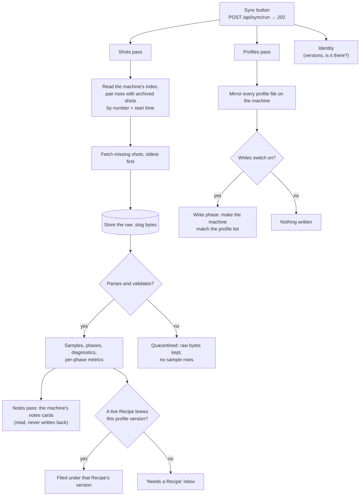

# Sync and the archive

Pressing **Sync** in the top bar (on any page) is how the archive fills. It is the only thing that starts a pass over the machine's shots, notes or profiles: no timer, no pass triggered by a machine event. "I have pulled some coffee, take it" is what an archive is actually asked for; the machine's own web UI already draws the shot that is happening now.

## What a sync does

The route answers 202 at once: the passes run in background loops that take the engine's lock in turn, and progress arrives on the event stream and on the Device page ("the last run of each sync pass"). Two clicks while a pass runs coalesce into one pass. The first sync walks the machine's whole history; for a few hundred shots that takes a minute or two. When it finishes it says what it archived and how many profiles it read and wrote ("Read 9 profiles from the machine; no writes (writes are off)").

The write phase at the end is described on [Profile sync](profile-sync.md); what guards it is on [Machine safety](safety-layers.md).

## How a shot is kept

| Step | What happens | Why |
|---|---|---|
| Raw first | The `.slog` bytes are stored before anything parses them | A parser bug can be fixed next week; the machine's copy may be gone by then |
| Quarantine | A shot that fails parsing or validation stays as raw bytes with `quarantined = 1`, and no sample rows | Nothing is lost, nothing bad is queryable; quarantined shots are read again at start, so a parser fix brings them back (this is how firmware 1.10 shots came back) |
| Identity | A shot is unique by machine number **and** start time | The machine's counter restarts after a settings erase, so a later shot can carry an old number |
| Oldest first | Missing shots are fetched oldest first | The machine deletes its oldest shots first when free space drops below 500 KB |
| Derived data | Diagnostics and metrics are rebuilt at boot from what is stored when the derivation changes | Data that moves without a schema step is derived, never hand-migrated |

**Filing.** A new shot is filed under the one live (not archived) Recipe whose current version names the shot's profile version. Otherwise it waits in the "needs a Recipe" inbox, because a mis-filed shot pollutes a trend chart nobody re-reads, while an unfiled one sits on a list with a button beside it. **Match by profile** runs the same rule over shots already waiting. The inbox leaves out quarantined and discarded shots: neither is waiting for an answer.

## Importing exports

The machine's web UI exports a shot as `shot-<id>.json` and a profile as `profile-<id>.json`. Those files are the only way back for a shot the machine has already deleted. They go in through the drop zone on the Shots page, **Upload profile** on the Profiles page, `POST /api/import`, or `gaggiclanker import <folder|file|zip>` (with `--replace` to overwrite). The importer writes the same tables the sync does, so importing first and connecting the machine later is fine: a shot the sync later serves is recognised as the one already stored. Importing the same shot twice is a no-op; a file that does not parse is reported on its own and the rest of the batch still lands. An uploaded profile appears switched off (or as a version of the profile with its name), so importing never changes what a sync does.

## The connection to the machine

`DeviceConnection` is the one owner of the machine client and the sync engine. Saving a new host, protocol, timeout or the sync switch rebuilds both live, with no restart. A change that would move the connection while a sync is using the machine is refused with a 409 naming it, and nothing is stored; a sync asked for during a change waits and goes to the new connection. A pass cut short by a rebuild or a shutdown is recorded as stopped, never as `ok`.

## Firmware behaviours the sync is built around

All verified against the firmware source; [Firmware behaviours](device-gotchas.md) has the full fifteen. The fake machine in `device/fake.py` reproduces the awkward ones, and the whole offline suite runs against it.

| Behaviour | Consequence here |
|---|---|
| No auth, no TLS, no CORS on the machine | gaggiclanker is already the strictest thing on that wire |
| Three WebSocket clients; a fourth evicts the **oldest** | Exactly one persistent socket, with backoff that resets only after a connection has lasted; fall back to polling, never a second socket |
| A `.slog` may be header-only while being written | A short file is retried, not stored as a shot |
| Shots of 7.5 s or less never appear | The firmware discards them |
| `/api/history` returns 503 during an OTA update, and unknown paths answer 200 with the machine's own web page | Back off on a 503; a 200 whose content type is not what was asked for is an error, so an HTML page is never parsed as a shot |
| Pressure and flow are zero on Standard boards; flow is modelled, weight needs a scale | Each shot records which signals were real, and a value not recorded is absent, never zero |
| The machine deletes its oldest shots below 500 KB free | Accepted, not managed: sync before it does |
| `GET /api/settings` returns the machine's passwords in plain text | Any key named for a password, token or secret is removed before the document is stored or shown |
| Firmware 1.10: shot file v8, profiles with a dose and a ratio stop, two system profiles (backflush, descale) it keeps for itself, at most ten starred | Supported; the simulator suite is pinned to 1.10 |
